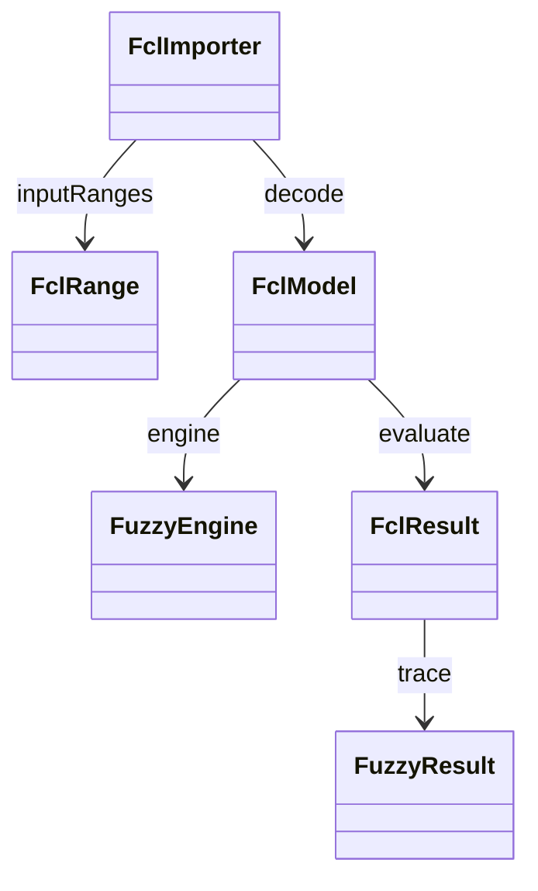

# Experimental FCL import

[Português](fcl.pt-BR.md)

`FclImporter` reads a deliberately restricted Mamdani FCL profile. Input universes
are explicit application configuration. Output RANGE and numeric DEFAULT are
required in the file. No controller code or arithmetic expression is executed.

```dart
final model = FclImporter(inputRanges: {
  'temperature': FclRange(0, 1),
  'humidity': FclRange(0, 1),
}).decode(source);
final result = model.evaluate({'temperature': .5, 'humidity': .75});
print(result.value);
print(result.usedDefault);
print(result.trace.rules.first.strength);
```

Run `dart run example/fcl_example.dart` from the repository root.

## Accepted grammar

One FUNCTION_BLOCK, VAR_INPUT and VAR_OUTPUT (REAL only), one FUZZIFY per input,
then one DEFUZZIFY and one RULEBLOCK. Exactly one output is supported.

FUZZIFY contains point terms: `TERM low := (0,1) (1,0);`. Each term has at least
two strictly increasing finite coordinates and degrees in [0,1]. Points must be
inside the explicit universe. Saturating endpoint tails are extended to universe
bounds before mapping to DiscreteSet; core DiscreteSet behavior is not changed.

DEFUZZIFY requires terms followed by `METHOD : COG;`, `DEFAULT := number;` and
`RANGE := (min .. max);`, in that order. RULEBLOCK requires AND:MIN, optional
OR:MAX, ACT:MIN and ACCU:MAX, then rules with numeric identifiers in 0..2147483647 (leading zeros normalize). A rule uses
`IF input IS [NOT] term [AND/OR ...] THEN output IS term [WITH weight];`.
Connectives must be homogeneous within a rule. Weights are finite in [0,1].
Keywords are case-insensitive; identifiers are case-sensitive. Non-nested
`(* comments *)` and ordinary whitespace are accepted. Unknown fields, custom
functions, NC/stateful defaults, other methods, parentheses around antecedents,
mixed connectives, extra blocks and unsupported types fail with FormatException
and a line number. Declaration order is part of this initial grammar.

## Evaluation and limits

`intervals=1000` samples the output at 1001 uniformly spaced points including
endpoints, using the core trapezoidal centroid. FCL does not store this resolution.
`evaluate` substitutes DEFAULT only for a null core decision (including sampled
zero area). `usedDefault` identifies substitution and `trace` retains the original
null output. DEFAULT is finite and may be outside RANGE; it is never clamped.
Direct `model.engine.evaluate` preserves the normal core null contract.

Limits: 1,000,000 UTF-16 source units, 100,000 tokens, 64 inputs, one output,
4096 rules, 64 terms per antecedent, 256 terms per variable and 4096 points per
term. Source/token/rule limits are configurable. Intervals must be 2..1,000,000.
Tokens are counted before model construction; there is no recursive expression
parser. Input validation still rejects missing/extra/out-of-range values.

32 tests include independent five-sample quadrature (235/44), DEFAULT with raw
null trace, saturating tails, malformed files, numeric limits and nine comparisons
to recorded scikit-fuzzy numerical references for an equivalent original FIS
model. The FCL fixture is original MIT-licensed data, not a vendor export.
The code was written independently, without vendoring jFuzzyLogic source.

This is not full IEC 61131-7 conformance or validation of an external FCL parser.
Direct jFuzzyLogic runtime comparison and FCL export remain pending. JSON and the
existing FIS codecs remain available for other supported models.



Primary references:
- https://jfuzzylogic.sourceforge.net/html/fcl.html
- https://github.com/pcingola/jFuzzyLogic/blob/master/src/net/sourceforge/jFuzzyLogic/membership/MembershipFunctionPieceWiseLinear.java
