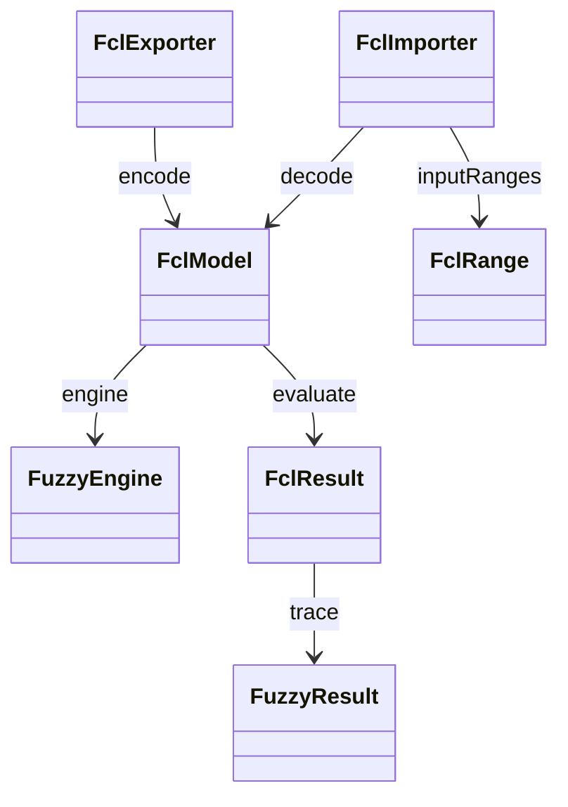

# Experimental FCL import

[Português](fcl.pt-BR.md)

`FclImporter` reads a deliberately restricted Mamdani FCL profile. Input universes
are explicit application configuration. Output RANGE and numeric DEFAULT are
required in the file. No controller code or arithmetic expression is executed.

```dart
final model = FclImporter(inputRanges: {
  'temperature': FclRange(0, 1),
  'humidity': FclRange(0, 1),
}).decode(source);
final result = model.evaluate({'temperature': .5, 'humidity': .75});
print(result.value);
print(result.usedDefault);
print(result.trace.rules.first.strength);
```

Run `dart run example/fcl_example.dart` from the repository root.

## Accepted grammar

One FUNCTION_BLOCK, VAR_INPUT and VAR_OUTPUT (REAL only), one FUZZIFY per input,
then one DEFUZZIFY and one RULEBLOCK. Exactly one output is supported.

FUZZIFY contains point terms: `TERM low := (0,1) (1,0);`. Each term has at least
two strictly increasing finite coordinates and degrees in [0,1]. Points must be
inside the explicit universe. Saturating endpoint tails are extended to universe
bounds before mapping to DiscreteSet; core DiscreteSet behavior is not changed.

DEFUZZIFY requires terms followed by `METHOD : COG;`, `DEFAULT := number;` and
`RANGE := (min .. max);`, in that order. RULEBLOCK requires AND:MIN, optional
OR:MAX, ACT:MIN and ACCU:MAX, then rules with numeric identifiers in 0..2147483647 (leading zeros normalize). A rule uses
`IF input IS [NOT] term [AND/OR ...] THEN output IS term [WITH weight];`.
Connectives must be homogeneous within a rule. Weights are finite in [0,1].
Keywords are case-insensitive; identifiers are case-sensitive. Non-nested
`(* comments *)` and ordinary whitespace are accepted. Unknown fields, custom
functions, NC/stateful defaults, other methods, parentheses around antecedents,
mixed connectives, extra blocks and unsupported types fail with FormatException
and a line number. Declaration order is part of this initial grammar.

## Evaluation and limits

`intervals=1000` samples the output at 1001 uniformly spaced points including
endpoints, using the core trapezoidal centroid. FCL does not store this resolution.
`evaluate` substitutes DEFAULT only for a null core decision (including sampled
zero area). `usedDefault` identifies substitution and `trace` retains the original
null output. DEFAULT is finite and may be outside RANGE; it is never clamped.
Direct `model.engine.evaluate` preserves the normal core null contract.

Limits: 1,000,000 UTF-16 source units, 100,000 tokens, 64 inputs, one output,
4096 rules, 64 terms per antecedent, 256 terms per variable and 4096 points per
term. Source/token/rule limits are configurable. Intervals must be 2..1,000,000.
Tokens are counted before model construction; there is no recursive expression
parser. Input validation still rejects missing/extra/out-of-range values.

32 tests include independent five-sample quadrature (235/44), DEFAULT with raw
null trace, saturating tails, malformed files, numeric limits and nine comparisons
to recorded scikit-fuzzy numerical references for an equivalent original FIS
model. The FCL fixture is original MIT-licensed data, not a vendor export.
The code was written independently, without vendoring jFuzzyLogic source.

This is not full IEC 61131-7 conformance or validation of an external FCL parser.
Direct jFuzzyLogic runtime comparison and restricted FCL export are implemented
(see below). JSON and the
existing FIS codecs remain available for other supported models.



Primary references:
- https://jfuzzylogic.sourceforge.net/html/fcl.html
- https://github.com/pcingola/jFuzzyLogic/blob/master/src/net/sourceforge/jFuzzyLogic/membership/MembershipFunctionPieceWiseLinear.java

## Export and direct jFuzzyLogic validation

```dart
final text = const FclExporter().encode(
  model, acknowledgeRuntimeSettings: true,
);
```

Use `FclModel.fromEngine(name: ..., ruleBlockName: ..., engine: ...,
defaultValue: ...)` to wrap a Dart model. The exporter accepts only DiscreteSet
terms, standard complement, min conjunction/implication, max disjunction/aggregation
and Centroid. It preserves canonical numeric rule IDs, weights, names, output
range and DEFAULT. Arbitrary functions, hedges, negated groups and mixed nested
connectives throw UnsupportedError. Names must be non-reserved ASCII identifiers starting with a letter.
Input/output identifiers must be distinct. Source/depth budgets are configurable.

Input universes and integration intervals are **not serialized**; acknowledge
and transfer them separately. For a DiscreteSet strictly inside its universe,
nonzero endpoints would turn the core's zero outside support into FCL saturation;
the exporter rejects that discontinuity instead of approximating it. Zero tails
are safe. Redundant boundary plateaus introduced by import are omitted so a
4096-point original term remains inside the parser budget.

Direct execution uses unmodified upstream jFuzzyLogic commit
`1f421d1b176b39cd7d08fa8f4d712d733abf1116` (archive SHA-256
`7a30a415f48be4c679c25871e03507a475dddaccfdd5a9d3d46695171cc488a0`).
The source is built with Java 21 using `--release 8`, outside the Dart package;
it is an external LGPL test dependency, not vendored or linked into Dart.

72 live comparisons cover original/exported FCL, 36 model/input cases, endpoints,
overlap, saturation, DEFAULT and a deliberately narrow output. Memberships and
strengths agree within 1e-12; sampled curves within 1e-10. The test validates the
external FCL parser and runtime for these fixtures, not the full IEC standard.
Recorded references retain both native and mapped crisp results; 36 Dart tests
replay them without requiring Java. CI rebuilds the pinned external dependency
and runs the live comparison before publication.

**Different discretization:** jFuzzyLogic uses N left-endpoint samples (excluding
max), while our centroid uses N+1 samples with trapezoidal endpoint weights. For
external left sums L0=sum(mu) and L1=sum(x*mu), output bounds a,b and endpoint
degrees muA,muB, matching trapezoidal sums are:

- T0 = L0 + (muB-muA)/2
- T1 = L1 + (b*muB-a*muA)/2
- mapped output = T1/T0, or DEFAULT when T0 is zero.

The test checks the original jFuzzyLogic result against L1/L0 separately and
compares every sampled degree before applying this exact conversion. It never
asserts that unconfigured native crisp values are identical. For ordinary fixture
cases the largest raw difference was about 0.004485. The narrow-output case has
positive membership only at max: jFuzzyLogic's grid returns DEFAULT=-1, whereas
the Dart grid returns 10. This occurs in eight original/exported comparisons,
with raw difference 11. After explicitly matching quadrature, maximum difference
was 9.77e-14. No core default or integration convention was changed to conceal it.

Reproduce from the repository root (Java 21, Python 3, Dart, curl and unzip):

```sh
bash tool/jfuzzylogic/run.sh
# Optional: regenerate the recorded references
JFUZZY_REFERENCE_OUT=test/fixtures/fcl/jfuzzylogic-reference.json bash tool/jfuzzylogic/run.sh
```
