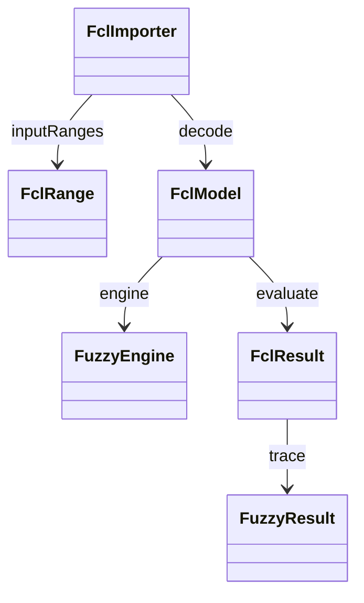

# Importação experimental FCL

[English](fcl.en.md)

`FclImporter` lê um perfil Mamdani restrito. Os universos das entradas são
configuração explícita da aplicação. A saída exige RANGE e DEFAULT numérico no
arquivo. Nenhum código de controlador ou expressão aritmética é executado.

```dart
final model = FclImporter(inputRanges: {
  'temperature': FclRange(0, 1),
  'humidity': FclRange(0, 1),
}).decode(source);
final result = model.evaluate({'temperature': .5, 'humidity': .75});
print(result.value);
print(result.usedDefault);
print(result.trace.rules.first.strength);
```

Execute `dart run example/fcl_example.dart` na raiz do repositório.

## Gramática aceita

Um FUNCTION_BLOCK, VAR_INPUT e VAR_OUTPUT apenas REAL, um FUZZIFY por entrada,
um DEFUZZIFY e um RULEBLOCK, nessa ordem. Há suporte a uma saída.

Os termos usam pontos: `TERM low := (0,1) (1,0);`, com pelo menos duas coordenadas
finitas estritamente crescentes e graus em [0,1]. Os pontos devem estar dentro do
universo explícito. As caudas saturadas são estendidas aos limites antes do
mapeamento para DiscreteSet, sem mudar o comportamento dessa função no núcleo.

DEFUZZIFY exige termos seguidos por `METHOD : COG;`, `DEFAULT := número;` e
`RANGE := (mínimo .. máximo);`, nessa ordem. RULEBLOCK exige AND:MIN, OR:MAX
opcional, ACT:MIN e ACCU:MAX, seguidos por regras com identificadores numéricos em 0..2147483647 (zeros iniciais são normalizados).
Regras usam `IF entrada IS [NOT] termo [AND/OR ...] THEN saída IS termo [WITH peso];`.
Cada regra deve usar conectivos homogêneos. Os pesos são finitos em [0,1].

Palavras-chave não diferenciam maiúsculas; identificadores diferenciam. São
aceitos comentários `(* ... *)` não aninhados e espaços/quebras de linha.
Campos desconhecidos, funções personalizadas, DEFAULT NC/com estado, outros
métodos, grupos entre parênteses, conectivos misturados, blocos extras e tipos não
suportados geram FormatException com a linha. A ordem declarada faz parte do perfil.

## Avaliação e limites

`intervals=1000` usa 1001 pontos uniformes na saída, incluindo os extremos, e o
centroide trapezoidal do núcleo. FCL não guarda essa resolução. `evaluate` usa
DEFAULT somente para uma decisão null, inclusive área amostrada zero. A propriedade
`usedDefault` indica substituição e `trace` preserva a saída null original.
DEFAULT deve ser finito e pode estar fora de RANGE; não é limitado automaticamente.
`model.engine.evaluate` mantém o contrato normal de null do núcleo.

Limites: 1.000.000 unidades UTF-16, 100.000 tokens, 64 entradas, uma saída, 4096
regras, 64 termos por antecedente, 256 termos por variável e 4096 pontos por termo.
Tamanho, tokens e regras são configuráveis. Intervalos devem ser 2..1.000.000.
Tokens são contados antes de construir o modelo; não há parser recursivo de
expressões. Entradas ausentes, extras ou fora do universo continuam rejeitadas.

32 testes incluem quadratura independente com cinco amostras (235/44), DEFAULT
com rastreamento null, caudas, arquivos inválidos, limites e nove comparações com
referências numéricas scikit-fuzzy registradas de um modelo FIS original equivalente.
A fixture FCL é original, sob MIT, sem exportação por fornecedor. O código foi
escrito independentemente, sem incorporar fontes de jFuzzyLogic.

Não há conformidade completa IEC 61131-7 nem validação de parser externo FCL.
Comparação direta com jFuzzyLogic e exportação FCL seguem pendentes. Os codecs
JSON e FIS existentes continuam disponíveis para os demais modelos suportados.



Referências primárias:
- https://jfuzzylogic.sourceforge.net/html/fcl.html
- https://github.com/pcingola/jFuzzyLogic/blob/master/src/net/sourceforge/jFuzzyLogic/membership/MembershipFunctionPieceWiseLinear.java
