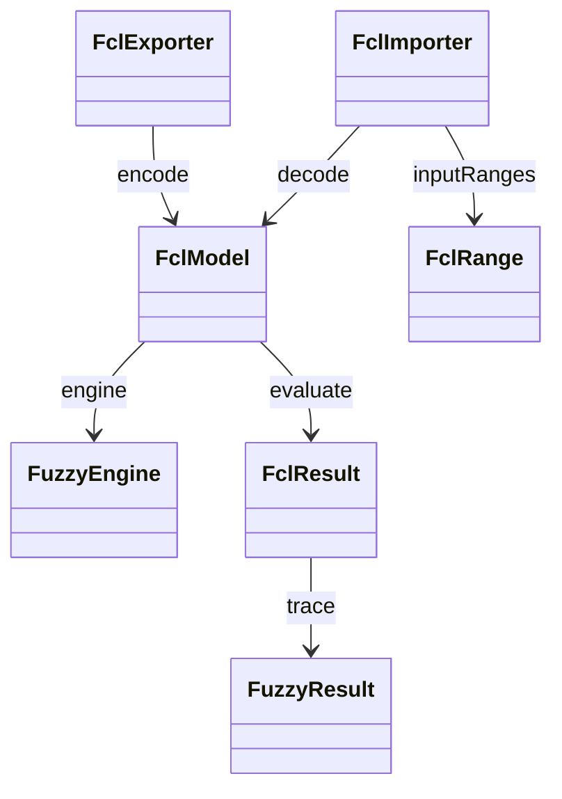

# Importação experimental FCL

[English](fcl.en.md)

`FclImporter` lê um perfil Mamdani restrito. Os universos das entradas são
configuração explícita da aplicação. A saída exige RANGE e DEFAULT numérico no
arquivo. Nenhum código de controlador ou expressão aritmética é executado.

```dart
final model = FclImporter(inputRanges: {
  'temperature': FclRange(0, 1),
  'humidity': FclRange(0, 1),
}).decode(source);
final result = model.evaluate({'temperature': .5, 'humidity': .75});
print(result.value);
print(result.usedDefault);
print(result.trace.rules.first.strength);
```

Execute `dart run example/fcl_example.dart` na raiz do repositório.

## Gramática aceita

Um FUNCTION_BLOCK, VAR_INPUT e VAR_OUTPUT apenas REAL, um FUZZIFY por entrada,
um DEFUZZIFY e um RULEBLOCK, nessa ordem. Há suporte a uma saída.

Os termos usam pontos: `TERM low := (0,1) (1,0);`, com pelo menos duas coordenadas
finitas estritamente crescentes e graus em [0,1]. Os pontos devem estar dentro do
universo explícito. As caudas saturadas são estendidas aos limites antes do
mapeamento para DiscreteSet, sem mudar o comportamento dessa função no núcleo.

DEFUZZIFY exige termos seguidos por `METHOD : COG;`, `DEFAULT := número;` e
`RANGE := (mínimo .. máximo);`, nessa ordem. RULEBLOCK exige AND:MIN, OR:MAX
opcional, ACT:MIN e ACCU:MAX, seguidos por regras com identificadores numéricos em 0..2147483647 (zeros iniciais são normalizados).
Regras usam `IF entrada IS [NOT] termo [AND/OR ...] THEN saída IS termo [WITH peso];`.
Cada regra deve usar conectivos homogêneos. Os pesos são finitos em [0,1].

Palavras-chave não diferenciam maiúsculas; identificadores diferenciam. São
aceitos comentários `(* ... *)` não aninhados e espaços/quebras de linha.
Campos desconhecidos, funções personalizadas, DEFAULT NC/com estado, outros
métodos, grupos entre parênteses, conectivos misturados, blocos extras e tipos não
suportados geram FormatException com a linha. A ordem declarada faz parte do perfil.

## Avaliação e limites

`intervals=1000` usa 1001 pontos uniformes na saída, incluindo os extremos, e o
centroide trapezoidal do núcleo. FCL não guarda essa resolução. `evaluate` usa
DEFAULT somente para uma decisão null, inclusive área amostrada zero. A propriedade
`usedDefault` indica substituição e `trace` preserva a saída null original.
DEFAULT deve ser finito e pode estar fora de RANGE; não é limitado automaticamente.
`model.engine.evaluate` mantém o contrato normal de null do núcleo.

Limites: 1.000.000 unidades UTF-16, 100.000 tokens, 64 entradas, uma saída, 4096
regras, 64 termos por antecedente, 256 termos por variável e 4096 pontos por termo.
Tamanho, tokens e regras são configuráveis. Intervalos devem ser 2..1.000.000.
Tokens são contados antes de construir o modelo; não há parser recursivo de
expressões. Entradas ausentes, extras ou fora do universo continuam rejeitadas.

32 testes incluem quadratura independente com cinco amostras (235/44), DEFAULT
com rastreamento null, caudas, arquivos inválidos, limites e nove comparações com
referências numéricas scikit-fuzzy registradas de um modelo FIS original equivalente.
A fixture FCL é original, sob MIT, sem exportação por fornecedor. O código foi
escrito independentemente, sem incorporar fontes de jFuzzyLogic.

Não há conformidade completa IEC 61131-7 nem validação de parser externo FCL.
A comparação direta com jFuzzyLogic e a exportação restrita FCL estão implementadas
(veja abaixo). Os codecs
JSON e FIS existentes continuam disponíveis para os demais modelos suportados.



Referências primárias:
- https://jfuzzylogic.sourceforge.net/html/fcl.html
- https://github.com/pcingola/jFuzzyLogic/blob/master/src/net/sourceforge/jFuzzyLogic/membership/MembershipFunctionPieceWiseLinear.java

## Exportação e comparação direta com jFuzzyLogic

```dart
final text = const FclExporter().encode(
  model, acknowledgeRuntimeSettings: true,
);
```

`FclModel.fromEngine(name: ..., ruleBlockName: ..., engine: ...,
defaultValue: ...)` permite envolver um modelo Dart. A exportação aceita somente
DiscreteSet, complemento padrão, conjunção/implicação min, disjunção/agregação max
e Centroid. Preserva IDs numéricos canônicos, pesos, nomes, RANGE de saída e DEFAULT.
Funções arbitrárias, modificadores, grupos negados e conectivos aninhados mistos
geram UnsupportedError. Nomes devem ser identificadores ASCII não reservados iniciados por letra;
entrada e saída devem ter nomes distintos. Há limites de texto e profundidade.

Universos das entradas e intervalos de integração **não são serializados**: devem
ser reconhecidos e transferidos separadamente. Termos DiscreteSet interiores ao
universo com extremos não nulos causariam uma descontinuidade entre suporte zero
e saturação FCL; são rejeitados, sem aproximação. Caudas zero são seguras. Platôs
redundantes adicionados pela importação são omitidos para respeitar 4096 pontos.

A execução direta usa o código oficial não modificado de jFuzzyLogic no commit
`1f421d1b176b39cd7d08fa8f4d712d733abf1116`, com SHA-256 do arquivo
`7a30a415f48be4c679c25871e03507a475dddaccfdd5a9d3d46695171cc488a0`.
A compilação usa Java 21 e `--release 8`, fora do pacote Dart. É uma dependência
externa de teste LGPL, sem incorporação do código Java ao motor Dart.

Passaram 72 comparações ao vivo: arquivos originais/exportados, 36 combinações de
modelo/entradas, extremos, sobreposição, saturação, DEFAULT e saída estreita.
Graus e ativações concordam em 1e-12; curvas amostradas, em 1e-10. Isso valida o
parser e o runtime externos para essas fixtures, sem certificar todo o padrão IEC.
As referências registram valores nativos e convertidos; 36 testes Dart repetem a
verificação sem Java. O CI compila a dependência fixada e executa a comparação.

**A discretização difere:** jFuzzyLogic usa N pontos à esquerda, sem o máximo;
o núcleo usa N+1 pontos e pesos trapezoidais nos extremos. Se L0=sum(mu),
L1=sum(x*mu), a/b são os limites e muA/muB os graus extremos, a conversão é:

- T0 = L0 + (muB-muA)/2
- T1 = L1 + (b*muB-a*muA)/2
- saída convertida = T1/T0, ou DEFAULT quando T0 é zero.

O teste confere o valor nativo com L1/L0 e compara cada grau antes da conversão.
Não afirma igualdade dos resultados crisp nativos sem configurar a quadratura.
Nos casos comuns a maior diferença bruta foi aproximadamente 0,004485. Na saída
estreita, só o máximo tem pertinência positiva: a malha Java retorna DEFAULT=-1,
e a malha Dart retorna 10. Isso ocorre em oito comparações, com diferença bruta 11.
Após a conversão explícita, a maior diferença foi 9,77e-14. Os padrões do núcleo
não foram alterados para ocultar essas diferenças.

Execute na raiz (Java 21, Python 3, Dart, curl e unzip):

```sh
bash tool/jfuzzylogic/run.sh
# Para regenerar as referências:
JFUZZY_REFERENCE_OUT=test/fixtures/fcl/jfuzzylogic-reference.json bash tool/jfuzzylogic/run.sh
```
