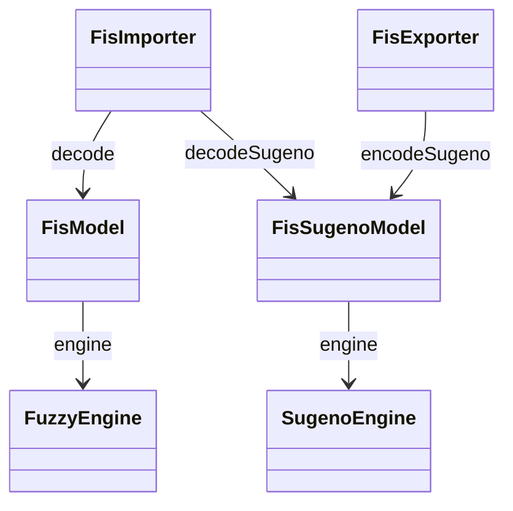

# Experimental FIS interchange

[Português](fis.pt-BR.md) · [Interoperability roadmap](interoperability.en.md)

Import and export a restricted, type-1, single-output Mamdani or Sugeno text `.fis`
model without Dart runtime dependencies. This is a tested subset, not full MATLAB
compatibility. FCL, type-2, arbitrary functions and multi-output files are pending.

```dart
final importer = FisImporter(
  noDecisionPolicy: FisNoDecisionPolicy.preserveNull,
  intervals: 1000,
);
final model = importer.decode(source); // Mamdani; use decodeSugeno for Sugeno.
final result = model.evaluate({'temperature': .5, 'humidity': .75});
final text = const FisExporter().encodeMamdani(
  model.engine,
  name: model.name,
  acknowledgeRuntimeSettings: true,
);
```

For Sugeno, use `importer.decodeSugeno(source)` and
`FisExporter().encodeSugeno(model, acknowledgeRuntimeSettings: true)`. Both
weighted average (`wtaver`) and weighted sum (`wtsum`) are supported. A constant
has one parameter; linear parameters follow declared input order with intercept
last: `[coefficient1 coefficient2 ... intercept]`.

`FisSugenoModel` retains the finite FIS output range and named consequent catalog,
including unused terms. Its public constructor also accepts a Dart Sugeno engine
with an explicit range and catalog; rules must use instances from that catalog.
The range is used for midpoint fallback only, never clamping a crisp output.

Run the console example from the repository root:

```sh
dart run example/fis_example.dart test/fixtures/fis/ventilation.fis
dart run example/fis_roundtrip_example.dart
```

## Accepted profile

| Area | Supported |
| --- | --- |
| Sections | Exactly System, contiguous Input1..N, Output1, Rules; order independent |
| System | Name, Type, NumInputs, NumOutputs, NumRules, AndMethod, OrMethod, ImpMethod, AggMethod, DefuzzMethod; optional Version=2.0 |
| Inputs / Mamdani output | Name, finite increasing Range, NumMFs, contiguous MF1..N |
| Memberships | trimf [a b c], trapmf [a b c d], gaussmf [sigma center] |
| Sugeno output | Name, finite Range, constant/linear consequent MFs |
| Antecedents | Integer MF indices; zero ignores an input; negative complements a term; at least one nonzero input |
| Consequent | One positive MF index, weight in [0,1] |
| Connectives | 1=flat AND, 2=flat OR; min/prod AND, max/probor OR |
| Mamdani | min/prod implication, max aggregation, centroid |
| Sugeno | ImpMethod=prod, AggMethod=sum, DefuzzMethod=wtaver/wtsum |
| Text | Case-sensitive fields; nonempty single-quoted names without embedded quotes; whitespace-separated decimal vectors; percent comments outside quotes; LF or CRLF |

No unknown field is silently discarded. Unsupported syntax/components cause
FormatException with a line number (source size and missing System errors are
file-level). Export throws UnsupportedError for mixed nested connectives,
multiple references to the same input in a rule, negated groups, hedges, custom
components, unsupported methods or names containing quotes/line breaks.

## Settings outside the file

FIS does not store our rule names, integration resolution or no-decision policy.
Export requires `acknowledgeRuntimeSettings: true`; false throws ArgumentError.
Rules become positional rule1, rule2, etc. Preserve application metadata and units
using the package JSON codec. Export does not claim lossless runtime serialization.

`noDecisionPolicy` is required on import. `preserveNull` keeps null;
`midpoint` substitutes the universe midpoint; `throwError` fails.
For Mamdani this includes zero sampled area even if a rule fired. `usedFallback`
identifies substitution; `trace` always retains the unmodified core result.
Calling `model.engine.evaluate` bypasses the adapter policy. Input validation
still rejects missing, extra, nonfinite and out-of-range values. Vendor warnings
and previous-value policies are not emulated.

Mamdani `intervals=1000` means 1001 equally spaced samples, including endpoints,
with composite trapezoidal centroid integration. Match resolution deliberately;
matching sample count does not imply matching integration conventions.

Import limits default to 1,000,000 UTF-16 code units, 64 inputs, 4096 rules and
256 MFs per variable. Intervals must be 2..1,000,000. Caller-supplied larger count
limits permit more work deliberately. Export limits condition depth to 64 and
source length to 1,000,000 code units by default; it also enforces the default
64-input, 4096-rule and 256-MF profile counts. No file text is executed.

## External numerical validation

The reproducible comparison uses scikit-fuzzy 0.5.0 for membership functions and
Mamdani centroid, and NumPy 2.2.6 for an independent Sugeno reduction. Python parses
the FIS text independently; it does not import or translate Dart inference code.
Original and exported files passed **126 comparisons across 63 input/model cases**:
endpoints, overlap, no activation, Gaussian input, product/probor methods,
constant/linear consequents and both Sugeno reductions. Memberships, strengths and
sampled Mamdani curves use absolute tolerance 1e-12.

scikit-fuzzy integrates the sampled piecewise-linear moment exactly; our core uses
trapezoidal moment quadrature. On a uniform grid of spacing h and sampled area A,
the crisp difference bound is `h² * |lastDegree - firstDegree| / (6*A)` plus
1e-10 for floating arithmetic. Both integrate sampled area trapezoidally. Maximum
observed crisp difference was 0.000003333334, within this derived bound.
No-decision cases compare null before any adapter fallback.

The recorded external reference contains source hashes, input memberships,
strengths and crisp outputs; 63 Dart regression tests run without Python.
CI also executes the live comparison with pinned test-only dependencies:

```sh
python -m pip install -r tool/external-requirements.txt
dart run tool/export_external_cases.dart > /tmp/fis-cases.json
python tool/compare_external.py /tmp/fis-cases.json
# Optional second argument regenerates the recorded reference:
# test/fixtures/fis/external-reference.json
```

Fixtures were authored for this project, not exported by MATLAB. These checks
validate this subset numerically against independent libraries; they do not
certify MATLAB parsing or full vendor/standard conformance. See fixture provenance
in test/fixtures/fis/README.md and [validation evidence](VALIDATION.md).



Primary references:
- [Text FIS structure](https://help.functionbay.com/2026/RecurDynHelp/Colink/Colink_ch06_s12_02.html)
- [Gaussian parameters](https://www.mathworks.com/help/fuzzy/gaussmf.html)
- [Sugeno model](https://www.mathworks.com/help/fuzzy/sugfis.html)
- [Evaluation options](https://la.mathworks.com/help/fuzzy/fuzzy.evalfis.evalfisoptions.html)
- [scikit-fuzzy defuzzification](https://scikit-fuzzy.github.io/scikit-fuzzy/auto_examples/plot_defuzzify.html)
