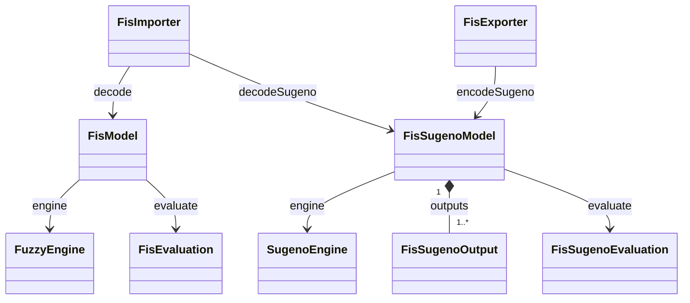

# Intercâmbio experimental FIS

[English](fis.en.md) · [Roadmap](interoperability.pt-BR.md)

Importe e exporte um perfil restrito de `.fis` Mamdani ou Sugeno tipo 1, com múltiplas
saídas e sem dependências de execução no Dart. O perfil foi testado, mas não implica
compatibilidade completa com MATLAB. Tipo 2 e funções arbitrárias continuam fora desse perfil. FCL restrito tem um [guia próprio](fcl.pt-BR.md).

```dart
final importer = FisImporter(
  noDecisionPolicy: FisNoDecisionPolicy.preserveNull,
  intervals: 1000,
);
final model = importer.decode(source); // Mamdani; decodeSugeno para Sugeno.
final result = model.evaluate({'temperature': .5, 'humidity': .75});
final text = const FisExporter().encodeMamdani(
  model.engine,
  name: model.name,
  acknowledgeRuntimeSettings: true,
);
```

Para Sugeno, use `importer.decodeSugeno(source)` e
`FisExporter().encodeSugeno(model, acknowledgeRuntimeSettings: true)`. São aceitas
média ponderada (`wtaver`) e soma ponderada (`wtsum`). Constantes têm um parâmetro;
lineares seguem a ordem declarada das entradas, com intercepto no fim:
`[coeficiente1 coeficiente2 ... intercepto]`.

`FisSugenoModel` conserva o intervalo de saída e o catálogo de consequentes,
inclusive termos não usados. Seu construtor público também aceita um motor Dart
Sugeno com intervalo e catálogo explícitos; as regras devem usar instâncias desse
catálogo. O intervalo serve apenas ao fallback de ponto médio e não limita saídas.

Execute o exemplo na raiz:

```sh
dart run example/fis_example.dart test/fixtures/fis/ventilation.fis
dart run example/fis_roundtrip_example.dart
```

## Múltiplas saídas

`decode` e `decodeSugeno` aceitam de `[Output1]` a `[OutputM]`, sem lacunas.
Leia `result.values['fan']` e `result.values['heater']`. O conjunto imutável
`fallbackOutputs` identifica exatamente quais saídas usaram ponto médio;
`usedFallback` indica que pelo menos uma usou. A política atua por saída.
`throwError` falha se qualquer saída ficar sem decisão, identificando seu nome.
`trace` sempre conserva os nulls e as ativações originais.

Cada linha contém um índice de consequente por saída. Zero ignora aquela saída,
sem acrescentar regra nem peso ao denominador Sugeno dela. Índices negativos ou
fracionários e linhas que ignoram todas as saídas são rejeitados.
Linhas com vários consequentes viram uma regra do motor por saída não ignorada.
Os nomes no trace são `ruleN:outputM`; com uma saída continuam `ruleN`.
A exportação escreve uma linha por regra do motor, preenchendo as outras saídas
com zero. Preserva a inferência suportada por saída, sem preservar o agrupamento
original de linhas ou a grafia do arquivo.

O acesso `result.value` e o construtor `FisSugenoModel` de saída única continuam
funcionando. `.value`, `.consequents`, `.outputMin` e `.outputMax` são atalhos
para saída única e lançam `StateError` em modelos com várias saídas.
Para criar Sugeno com várias saídas, use `FisSugenoModel.multiOutput` e
`outputs: {'fan': FisSugenoOutput(min: 0, max: 100, consequents: catalog), ...}`.
Os metadados devem corresponder exatamente às saídas do motor. Cada regra deve
referenciar uma instância do catálogo da sua própria saída. Nomes de termos podem
se repetir entre saídas; catálogos não usados e ordem declarada são preservados.

```sh
dart run example/fis_multi_output_example.dart
# Acrescente --sugeno para avaliar a fixture Sugeno.
```

## Perfil aceito

| Área | Suporte |
| --- | --- |
| Seções | System, Input1..N e Output1..M contíguos e Rules; ordem livre |
| Sistema | Name, Type, NumInputs, NumOutputs, NumRules, AndMethod, OrMethod, ImpMethod, AggMethod, DefuzzMethod; Version=2.0 opcional |
| Entradas / saída Mamdani | Name, Range finito e crescente, NumMFs e MF1..N contíguos |
| Pertinência | trimf [a b c], trapmf [a b c d], gaussmf [sigma centro] |
| Saída Sugeno | Name, Range finito, consequentes constant/linear |
| Antecedentes | Índices inteiros; zero ignora entrada; negativo complementa termo; pelo menos uma entrada não ignorada |
| Consequente | Um índice por saída; zero ignora a saída, positivo seleciona função; pelo menos um não zero; peso em [0,1] |
| Conectivos | 1=AND plano, 2=OR plano; AND min/prod e OR max/probor |
| Mamdani | Implicação min/prod, agregação max e centroide |
| Sugeno | ImpMethod=prod, AggMethod=sum, DefuzzMethod=wtaver/wtsum |
| Texto | Sensível a maiúsculas; nomes não vazios em aspas simples sem aspas internas; vetores decimais separados por espaço; comentários % fora de aspas; LF ou CRLF |

Campos desconhecidos nunca são descartados. Sintaxe/componentes não suportados
geram FormatException com linha; tamanho global e ausência de System são erros
do arquivo inteiro. A exportação lança UnsupportedError para conectivos aninhados
misturados, referências repetidas à mesma entrada por regra, grupos negados,
modificadores, componentes personalizados, métodos não suportados e nomes com
aspas/quebras de linha.

## Configurações externas ao arquivo

FIS não armazena nossos nomes de regras, resolução ou política sem decisão.
A exportação exige `acknowledgeRuntimeSettings: true`; false gera ArgumentError.
Regras tornam-se rule1, rule2 etc. Use JSON para preservar metadados e unidades.
A exportação não promete serialização integral da configuração de execução.

`noDecisionPolicy` é obrigatório na importação. `preserveNull` mantém null;
`midpoint` usa o ponto médio do universo; `throwError` lança erro. Mamdani inclui
área amostrada zero mesmo com regra ativa. `usedFallback` indica substituição;
`trace` mantém o resultado original. `model.engine.evaluate` ignora a política do
adaptador. Entradas ausentes, extras, não finitas e fora do intervalo continuam
rejeitadas. Avisos de fornecedores e retenção do valor anterior não são emulados.

No Mamdani, `intervals=1000` usa 1001 amostras uniformes, incluindo extremos, e
centroide por integração trapezoidal composta. Igualar quantidade de amostras não
garante a mesma convenção de integração.

Limites padrão de importação: 1.000.000 unidades UTF-16, 64 entradas, 64 saídas, 4096 linhas/regras expandidas
e 256 funções por variável. Intervalos devem ser 2..1.000.000. Aumentar limites de
contagem permite mais trabalho deliberadamente. A exportação limita profundidade
a 64 e texto a 1.000.000 unidades, além das contagens padrão de 64 entradas, 64 saídas, 4096
regras e 256 funções. O texto nunca é executado como código.

## Validação numérica externa

A comparação reproduzível usa scikit-fuzzy 0.5.0 para pertinências e centroide
Mamdani, e NumPy 2.2.6 para redução Sugeno independente. O parser Python é separado;
não importa nem traduz a inferência Dart. Arquivos originais e exportados passaram
em **234 comparações de 117 combinações de modelo/entradas/saída**: extremos, sobreposição,
sem ativação, gaussiana, produto/probor, constantes/lineares e ambas as reduções.
Graus, ativações e curvas Mamdani usam tolerância absoluta de 1e-12.

scikit-fuzzy integra exatamente o momento da curva amostrada linear por partes;
o núcleo usa quadratura trapezoidal do momento. Para malha uniforme com passo h e
área A, o limite da diferença crisp é `h² * |grauFinal - grauInicial| / (6*A)`,
mais 1e-10 por aritmética de ponto flutuante. Ambos integram a área por trapézios.
A maior diferença observada foi 0,000016666667, dentro desse limite derivado.
Casos sem decisão comparam null antes de qualquer fallback.

A referência externa registrada inclui hashes das fontes, graus, ativações e
saídas. São 117 testes Dart de regressão que não precisam de Python. O CI também
executa a comparação ao vivo, com dependências de teste fixadas:

```sh
python -m pip install -r tool/external-requirements.txt
dart run tool/export_external_cases.dart > /tmp/fis-cases.json
python tool/compare_external.py /tmp/fis-cases.json
# Segundo argumento opcional para regenerar a referência:
# test/fixtures/fis/external-reference.json
```

As fixtures são originais deste projeto, sem exportação por MATLAB. A comparação
valida numericamente esse perfil contra bibliotecas independentes; não certifica
o parser MATLAB nem conformidade completa. Veja test/fixtures/fis/README.md e
[as evidências de validação](VALIDATION.md).



Referências primárias:
- [Estrutura FIS](https://help.functionbay.com/2026/RecurDynHelp/Colink/Colink_ch06_s12_02.html)
- [Parâmetros gaussianos](https://www.mathworks.com/help/fuzzy/gaussmf.html)
- [Modelo Sugeno](https://www.mathworks.com/help/fuzzy/sugfis.html)
- [Opções de avaliação](https://la.mathworks.com/help/fuzzy/fuzzy.evalfis.evalfisoptions.html)
- [Defuzzificação scikit-fuzzy](https://scikit-fuzzy.github.io/scikit-fuzzy/auto_examples/plot_defuzzify.html)
