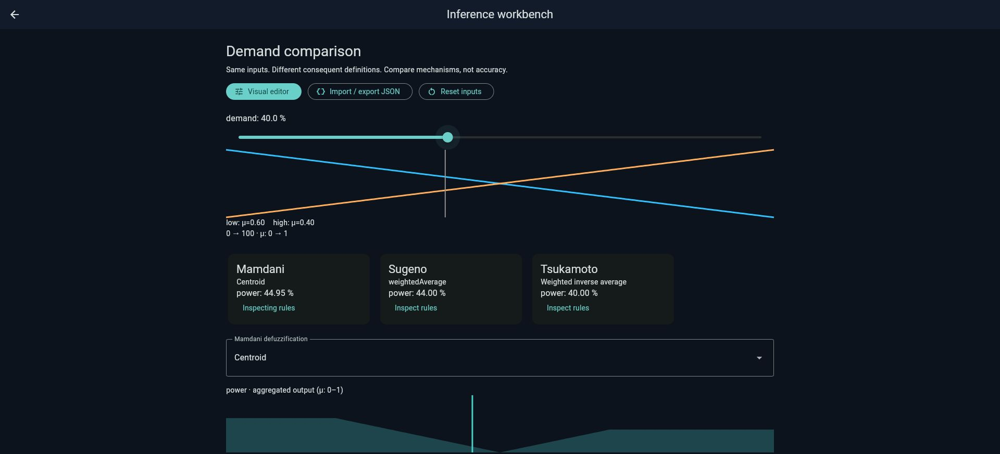
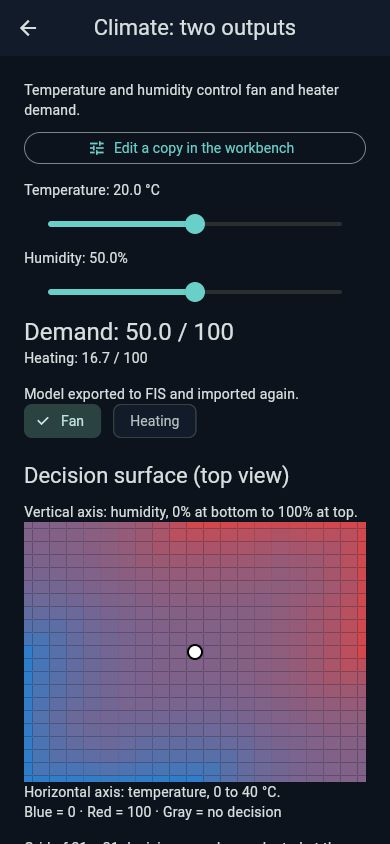
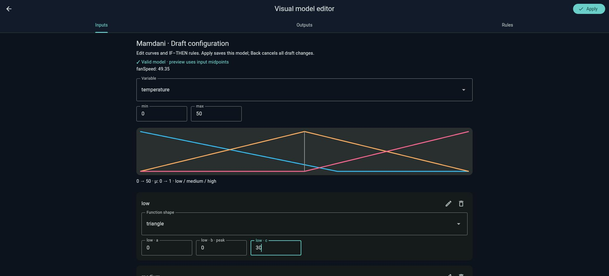
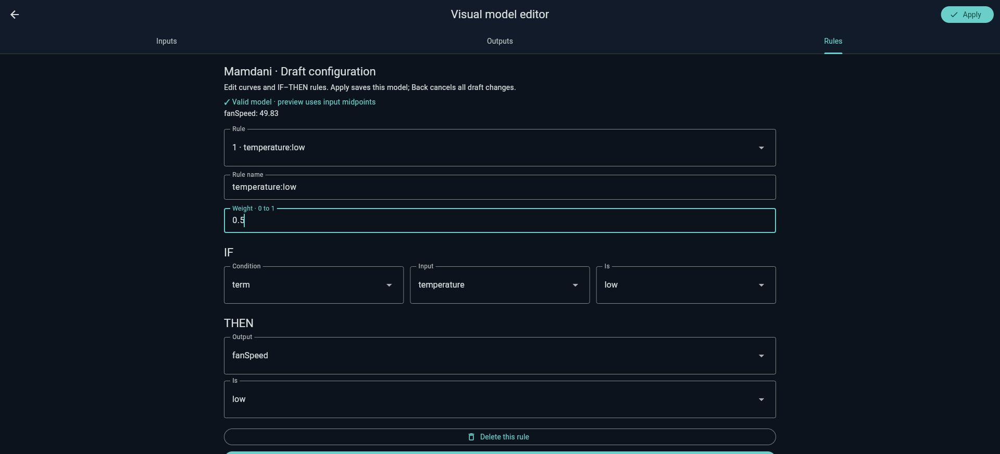
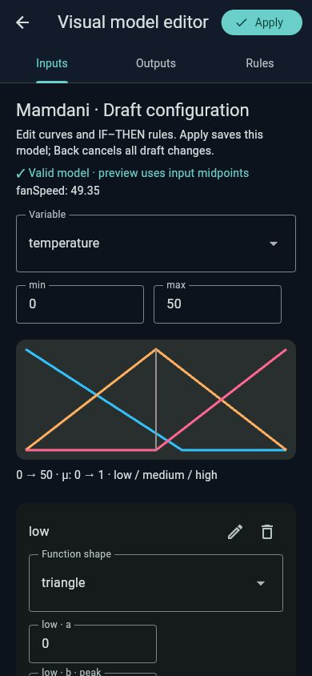
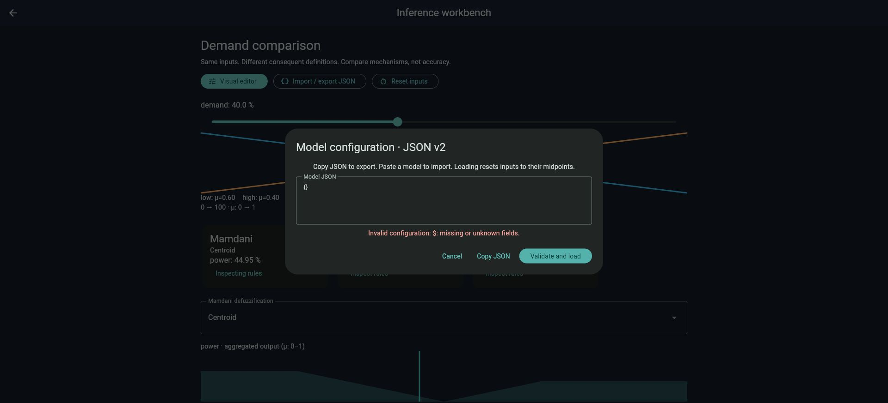
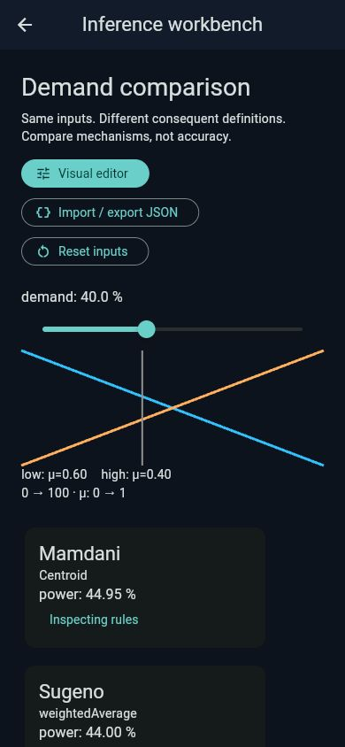

# Fuzzy Lab: scenarios and limits

[Open the verified online lab](https://kleberandrade.github.io/fuzzy-engine/).

The Flutter UI runs the same pure Dart inference engines as the console examples.
Start at the home screen. **English / Português** changes interface language;
variable and term identifiers remain stable so they match JSON and source code.

Real Chrome capture of the Web build, November 17, 2026. Demand 40 produces
Mamdani 44.95, Sugeno 44.00 and Tsukamoto 40.00 with the comparison presets.
This is a screenshot of the running implementation, not a conceptual illustration.

## Start with a scenario

- **Climate:** temperature 0–50 drives fan speed. At 25 the medium rule is fully
  active and the output is 50. At the endpoints, centroid outputs are approximately
  16.67 and 83.33; the shapes explain why they do not reach 0 and 100.
- **Irrigation:** soil moisture 0–100 drives watering. Dry soil activates high
  watering; wet soil activates low watering. At zero moisture, expect about 83.33.
- **Game:** performance 0–100 drives difficulty. This is an interpretable heuristic,
  not a learned policy or an assessment of an individual player.
- **Explore two inputs and outputs:** temperature 0–40 and humidity 0–100 control
  independent fan and heater demand. Switch the selected surface to inspect
  either output. Eighteen rules cover a cached 21 × 21 grid; the marker and numeric
  decisions use exact slider inputs. The model performs an explicit FIS round-trip.

Input curves show membership μ from zero to one; the vertical marker is the crisp
input. Numeric degrees and activation percentages explain the same information
without relying on curve colors. Fuzzy degrees are not probabilities.

## Compare inference families

Open **Compare and edit models**. A shared demand input (0–100)
fuzzifies into two ramps, low = 1 − demand/100 and high = demand/100. Each family
has its own consequent definition; their outputs are not interchangeable accuracy
scores and the presets are not calibrated controllers.

- **Mamdani:** low/high triangular output sets occupy 0–50 and 50–100. Minimum
  implication clips each set, maximum aggregation combines them, and a defuzzifier
  reduces 201 samples (200 intervals). Select Centroid, Bisector, Mean of maximum,
  Smallest of maximum or Largest of maximum. The filled curve is the aggregate;
  its vertical line marks the crisp output. Maximum methods can jump as the
  dominant peak changes; that is expected behavior.
- **Sugeno:** low/high rules return crisp constants 20 and 80. The preset uses
  normalized weighted average, yielding 35 at demand 25. Inspect rules to see z
  and raw w×z. JSON also supports the core's linear consequents and weighted sum;
  weighted sum is not normalized and Sugeno outputs have no bounded fuzzy universe.
- **Tsukamoto:** the output terms are decreasing/increasing ramps over 0–100.
  Each active rule inverts its weighted strength; the final result is the weighted
  average of inverse values. Demand 25 gives inverse 25 for both rules and output
  25. Only monotonic, invertible terms are accepted by the core.

**Inspect rules** selects the family whose detailed activation bars are shown.
Changing the Mamdani defuzzifier changes only that model; the shared inputs and
other families are preserved. The original home scenarios remain independent.

## Configure curves and rules visually

The lab starts with a dark navy/teal theme. The sun/moon button on the home screen
switches to the light theme without discarding scenario edits; the choice lasts
for the current session. Reload starts dark again.

Choose **Edit scenario curves and rules** on the home screen, or **Visual editor**
in the workbench. On the climate surface, **Edit a copy in the workbench** opens
an independent copy with both inputs and both outputs; it does not mutate the
cached reference heatmaps.

- **Inputs:** select an existing variable, edit its min/max range, and add,
  rename or delete membership terms. Choose triangle, trapezoid, Gaussian, ramp,
  sigmoid, bell, S/Z/Pi shape, rectangle or a discrete point set. Edit numeric
  parameters or discrete x/μ rows; the valid curves and midpoint decision update
  immediately. Renaming a term updates its references without changing its color
  order. Deleting a referenced term blocks Apply until its rules are repaired.
- **Outputs:** edit Mamdani membership shapes/ranges, or Tsukamoto ramp/S/Z
  functions. Only these three output shapes implement the core's monotonic inverse
  contract. Sugeno has no output membership curves: edit its crisp consequents in Rules.
- **Rules:** select, add or delete a rule. Set its name and weight (0–1), build a
  term condition or nested AND/OR/NOT/Very/Somewhat expression, then select the
  target output and consequent term. For Sugeno, choose a constant or a linear
  intercept plus a coefficient for each input. Expand operand sections to edit
  deeper condition trees. Desktop leaf-condition fields sit side by side and
  stack on narrow screens.

The editor owns a separate draft and uses the same production codec and browser
budgets as JSON import. Invalid or incomplete numbers, unsupported references,
non-monotonic Tsukamoto outputs and impossible shapes disable **Apply** and show
an explanation. The preview uses each input's midpoint, not the last workbench
slider position; an uncovered midpoint displays **No decision**. No JSON editing
is needed for these rule and membership operations.

**Apply** updates the selected home scenario. When launched from the workbench,
it opens the edited model by itself and resets its inputs to midpoints, so a
changed input definition is not presented as a shared-input comparison with the
unchanged presets. **Restore comparison** returns to the presets. **Back** cancels
the entire uncommitted draft.
Applied edits live in memory; use JSON export from the workbench to save a copy.
For a home scenario, **Inspect/export this scenario** opens exactly its applied
configuration in the workbench before you copy JSON. Home scenario edits are
retained while switching scenarios and themes, and are cleared on reload.

The variable catalog and variable identifiers remain unchanged. Adding/renaming
variables, units, engine families and advanced operator/runtime settings remain
JSON/core configuration operations; the visual editor preserves those existing
settings rather than replacing them. Custom Dart functions cannot be serialized.

## Import, export and recover

**Import / export JSON** opens the selected model as formatted JSON v2, including
metadata, operators and runtime settings. **Copy JSON** exports text through the
clipboard; save it as a local `.json` file if needed. Paste a complete v1/v2 model
and choose **Validate and load**. A successful import replaces the comparison
with that model and initializes every input to its midpoint. Use **Restore
comparison** to return to the three presets. Imported models can have multiple
inputs and outputs; all are displayed.

The UI uses `FuzzyModelCodec` from the core. Unknown fields, versions, references,
invalid membership parameters, unsupported components and nonfinite numbers are
rejected. No code is evaluated. The browser adds limits of 100000 UTF-16 code
units, 2000 JSON nodes, depth 64, 8 inputs, 8 outputs, 64 rules, 10000 total Mamdani
output samples and 250000 rule/sample operations per evaluation. These UI limits
are intentionally smaller than the codec defaults. Configuration text remains
local; there is no upload service or server-side model execution.

Invalid imports leave the current model and inputs untouched and show an error.
**Cancel**, Escape or dismissing the dialog discards draft edits. **Reset inputs**
restores the current model's midpoints without replacing its configuration. Valid
but numerically extreme imported Sugeno models may overflow for particular inputs;
the UI displays a recoverable evaluation error. Reset or edit the configuration.
Zero activated area/weight is **No decision**, not zero output.

## Access and platform limits

The UI is scrollable; comparison cards stack on a narrow screen. Sliders support
keyboard adjustment, and buttons, numeric memberships and rule percentages are
exposed to accessibility semantics. Widget tests include a 390 × 844 viewport
with 150% text scale; Chrome was inspected at desktop size and at 390 × 844.
These checks are not a complete screen-reader or WCAG conformance audit.

There is no simulation clock or background training task. Decisions update
synchronously when inputs change, so pause/step controls do not apply. Reset and
configuration cancellation are tested. Large imported models are bounded to keep
the work on the UI thread small. Inputs/edits are in memory and are lost on reload.
The heatmap is educational sampling, not a proof of continuity or complete coverage
for arbitrary imported models. Core FIS/FCL profiles are restricted; the workbench
imports JSON rather than guessing unsupported vendor interchange semantics.

The verified target is Flutter Web in Chrome. Native runners are not included or
validated here. Clipboard export can be restricted by browser policy; the JSON
field remains selectable for manual copying. Thresholds and output percentages
are illustrative, not hardware commands, minutes, probabilities or safety controls.

## References and credits

- [Core guide](guide.en.md), [Portuguese guide](guide.pt-BR.md),
  [JSON v2 schema](model-v2.schema.json), [Tsukamoto details](tsukamoto.en.md).
- [Validation record and action log](lab-validation.md).
- UI and examples: Kleber Andrade, under the repository's [MIT license](../LICENSE).
  Flutter framework icons retain their upstream licensing. No third-party article,
  artwork or SDK source was incorporated into the package.

## Five practical exercises

1. **Explain overlap:** set demand to 40. Finish when you can record low 0.60,
   high 0.40 and the two weighted rule strengths without interpreting them as probabilities.
2. **Compare reductions:** keep demand at 25 and try all five Mamdani methods.
   Finish when you record the five outputs and explain centroid versus maximum selection.
3. **Explain consequent differences:** inspect Sugeno and Tsukamoto at demand 25.
   Finish when you reproduce 35 and 25 from the displayed strengths and consequents/inverses.
4. **Edit without JSON:** inspect Sugeno, open Visual editor → Rules and change
   the low rule's constant from 20 to 40. Finish when Apply produces 60 at demand
   50, Cancel preserves a previously applied model, and an invalid weight blocks Apply.
5. **Inspect two outputs:** open the climate surface, set temperature to 40 and
   humidity to zero, then switch fan/heater surfaces. Finish when you record both
   independent decisions and identify which rules drive each one.
