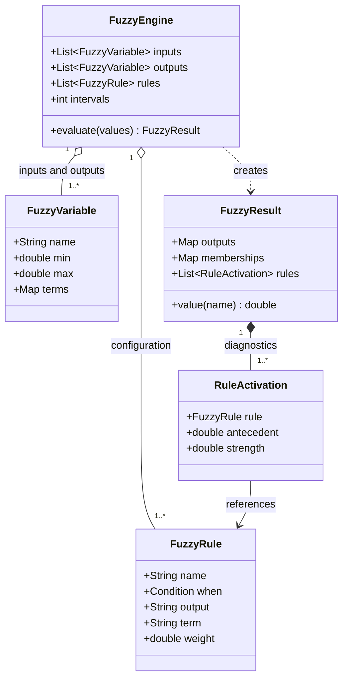
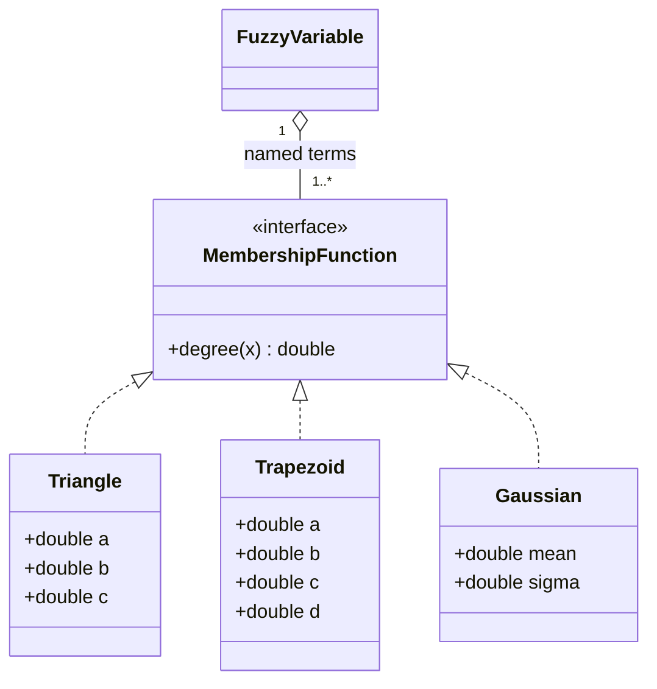
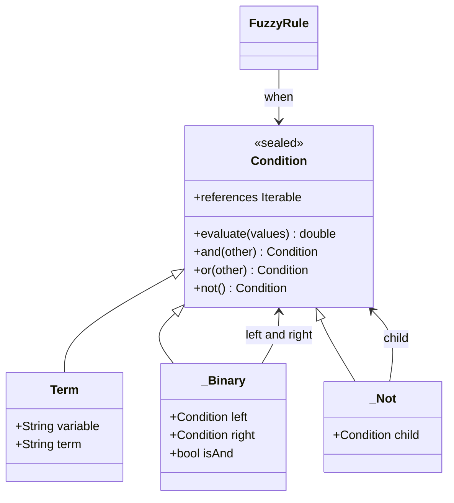

# Class diagrams and architecture

[Português](architecture.pt-BR.md) · [Scope and roadmap](roadmap.en.md)

These diagrams describe the implemented code, not planned features. They are
split into the engine model, membership functions and antecedent expressions.
GitHub renders these Mermaid blocks. A Markdown viewer without Mermaid support
may show source; API reference documentation is available through `dart doc`.

## Engine, configuration and results

`FuzzyEngine` copies configuration lists and validates references at construction.
Variables use the same class for inputs and outputs, but have separate namespaces.
Rule consequents reference output variables and terms by name, not object pointers.
`FuzzyResult.value()` returns **double?**: null means zero aggregated area. The
diagram omits nullability for renderer portability. Result maps/lists are immutable.
`RuleActivation` stores a reference to its rule and weighted/unweighted degrees;
it does not represent an additive share of the final centroid.

## Membership functions

`FuzzyVariable.terms` maps linguistic names to `MembershipFunction` instances.
These functions are referenced, not deeply copied. Custom implementations should
be immutable, deterministic and return finite degrees between zero and one.

## Conditions and composition

`Term` is public. `_Binary` and `_Not` are private implementation classes returned
by `and`, `or` and `not`; callers never instantiate them directly. `references`
collects input term references for eager validation. The built-in operations are
fixed: min AND, max OR, complement NOT. `Condition` is sealed; implementing a new
condition outside this library is not currently supported.

## Extension boundaries

Implementing `MembershipFunction` is the current custom extension point.
Inference, implication, aggregation and defuzzification strategies are hardcoded
in `FuzzyEngine`; there is no public strategy interface yet. Adding Sugeno should
introduce a distinct consequent model rather than treating crisp functions as
Mamdani membership sets. See the roadmap for the proposed sequencing.

Source: [engine](../lib/src/engine.dart), [model](../lib/src/model.dart),
[membership](../lib/src/membership.dart).
