# Class diagrams and architecture

[Português](architecture.pt-BR.md) · [Scope and roadmap](roadmap.en.md)

These diagrams describe the implemented code, not planned features. They are
split into the engine model, membership functions and antecedent expressions.
GitHub renders these Mermaid blocks. A Markdown viewer without Mermaid support
may show source; API reference documentation is available through `dart doc`.

## Engine, configuration and results

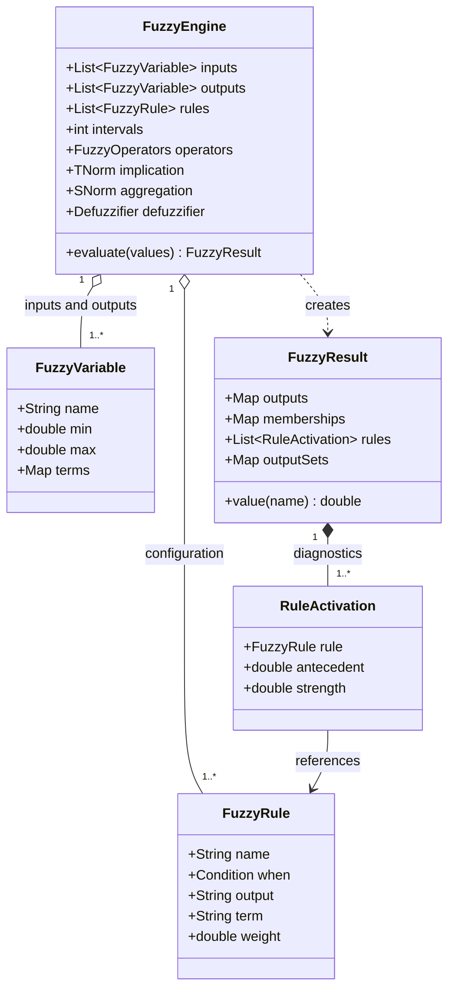

`FuzzyEngine` copies configuration lists and validates references at construction.
Variables use the same class for inputs and outputs, but have separate namespaces.
Rule consequents reference output variables and terms by name, not object pointers.
`FuzzyResult.value()` returns **double?**: null means zero aggregated area. The
diagram omits nullability for renderer portability. Result maps/lists are immutable.
`RuleActivation` stores a reference to its rule and weighted/unweighted degrees;
it does not represent an additive share of the final centroid.

## Membership functions

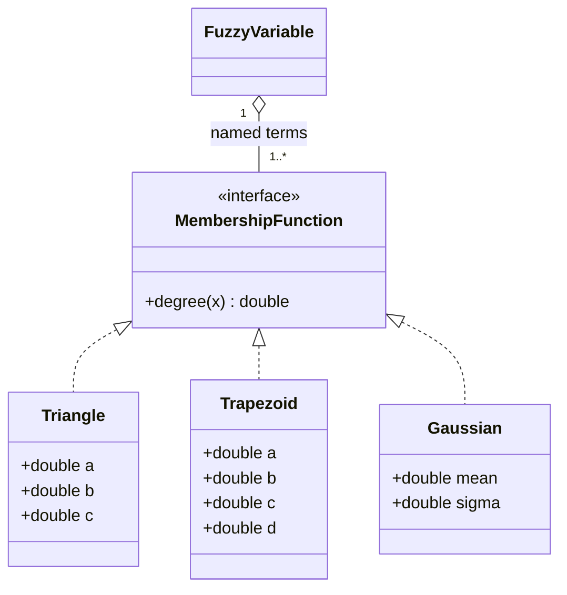

`FuzzyVariable.terms` maps linguistic names to `MembershipFunction` instances.
These functions are referenced, not deeply copied. Custom implementations should
be immutable, deterministic and return finite degrees between zero and one.

## Conditions and composition

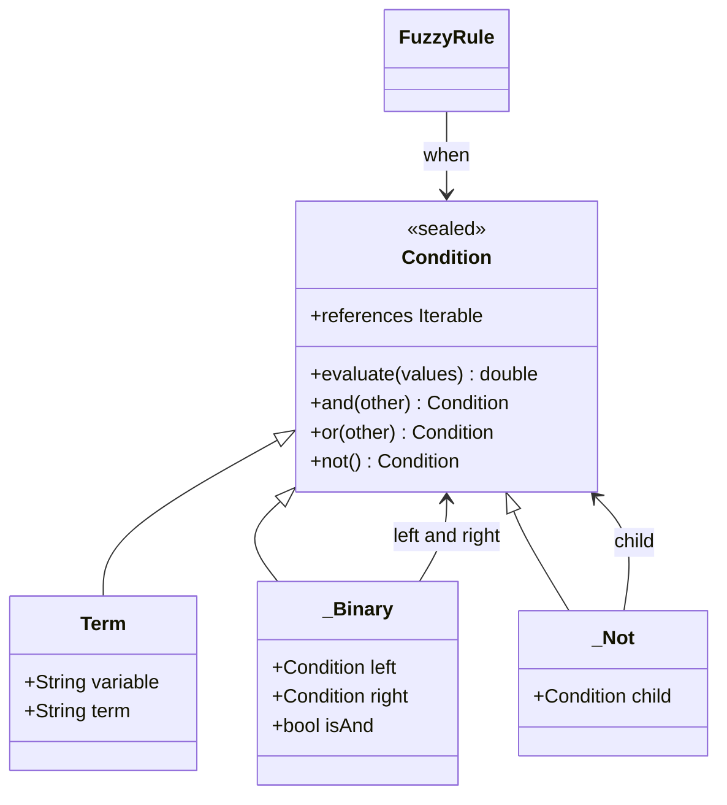

`Term` is public. `_Binary` and `_Not` are private implementation classes returned
by `and`, `or` and `not`; callers never instantiate them directly. `references`
collects input term references for eager validation. The default operations are
min AND, max OR, complement NOT; evaluation propagates the selected FuzzyOperators
through every nested expression. `Condition` is sealed; implementing a new
condition outside this library is not currently supported.

## Inference strategies

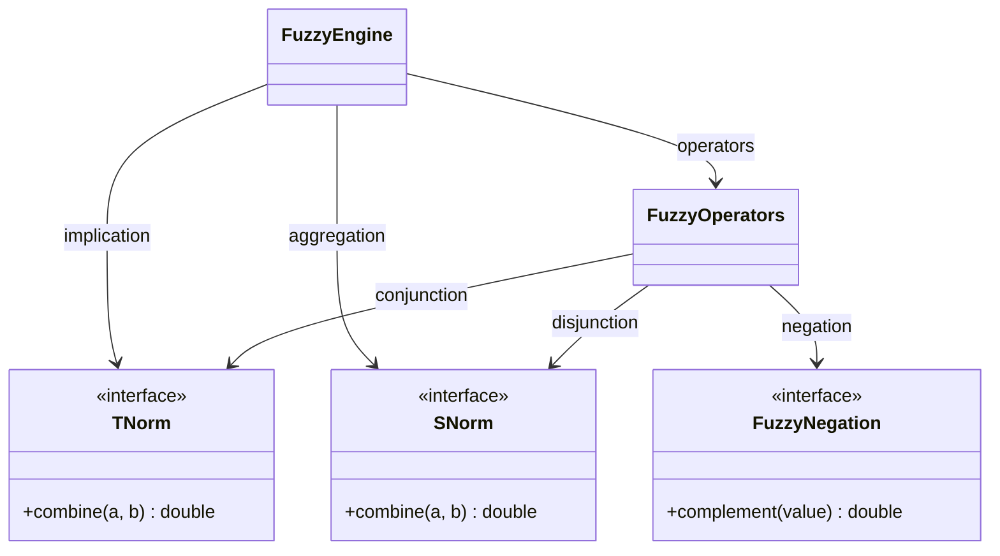

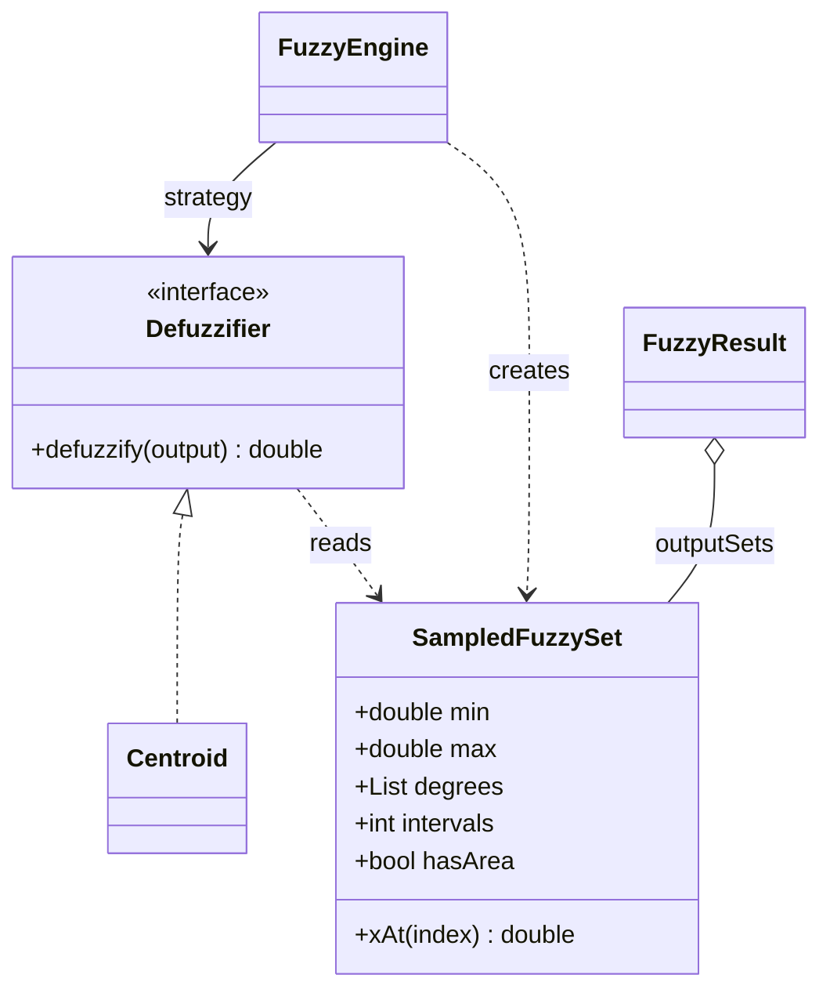

Implement `MembershipFunction`, `TNorm`, `SNorm`, `FuzzyNegation` or `Defuzzifier`
to customize the pipeline. `FuzzyEngine` applies selected strategies engine-wide.
`FuzzyResult.outputSets` exposes immutable aggregated samples. `Defuzzifier` returns
**double?**; nullability is omitted in the diagram for renderer portability.
See [strategy contracts and examples](strategies.en.md). Sugeno now has a separate
consequent model and engine, documented below.

Source: [engine](../lib/src/engine.dart), [model](../lib/src/model.dart),
[membership](../lib/src/membership.dart), [operators](../lib/src/operators.dart),
[defuzzification](../lib/src/defuzzification.dart).

## Additional membership classes / Classes adicionais de pertinência

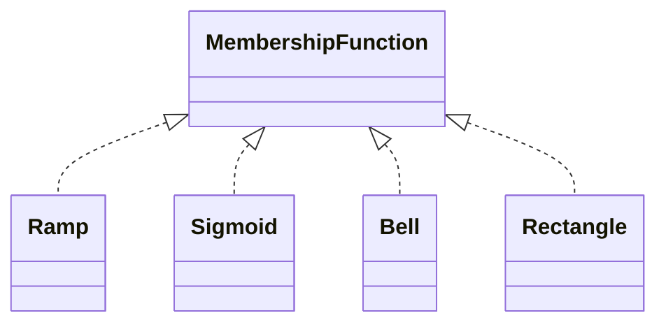

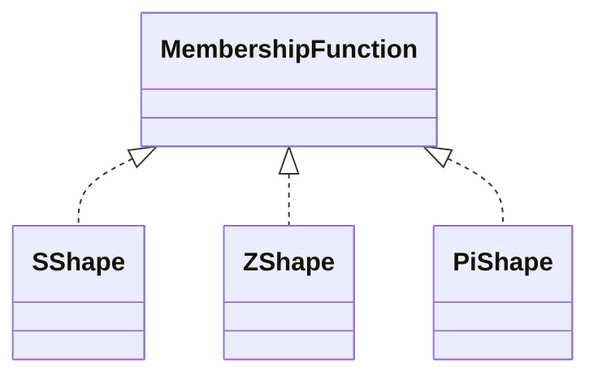

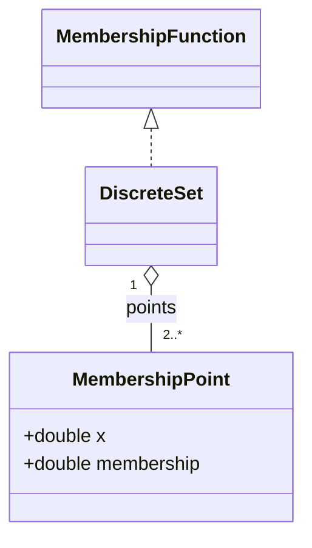

## Defuzzifier implementations / Implementações de defuzzificação

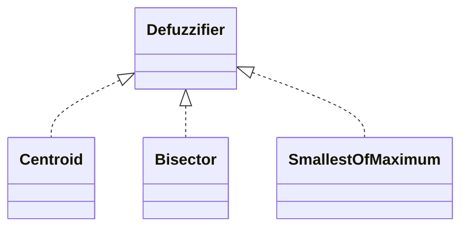

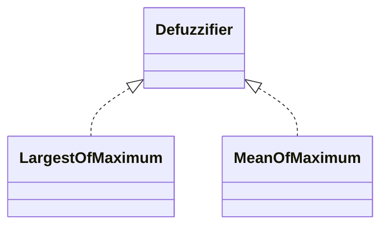

## Linguistic modifiers / Modificadores linguísticos

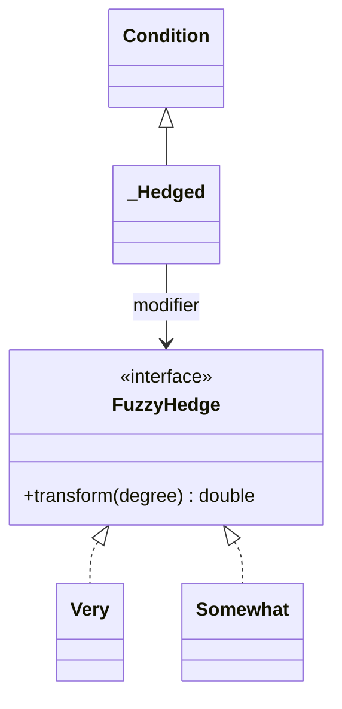

_MaximumDefuzzifier is a private implementation base, omitted from the overview; the three maxima strategies implement Defuzzifier through it. _Hedged is private and created by Condition.hedge. See [behavior contracts](toolbox.en.md).

## Sugeno

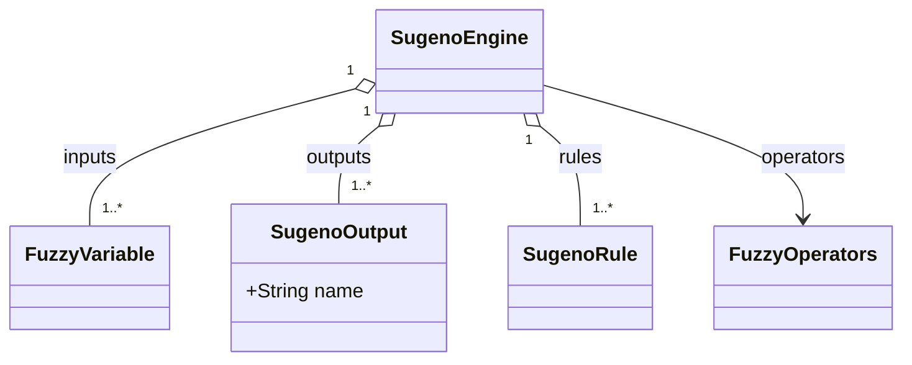

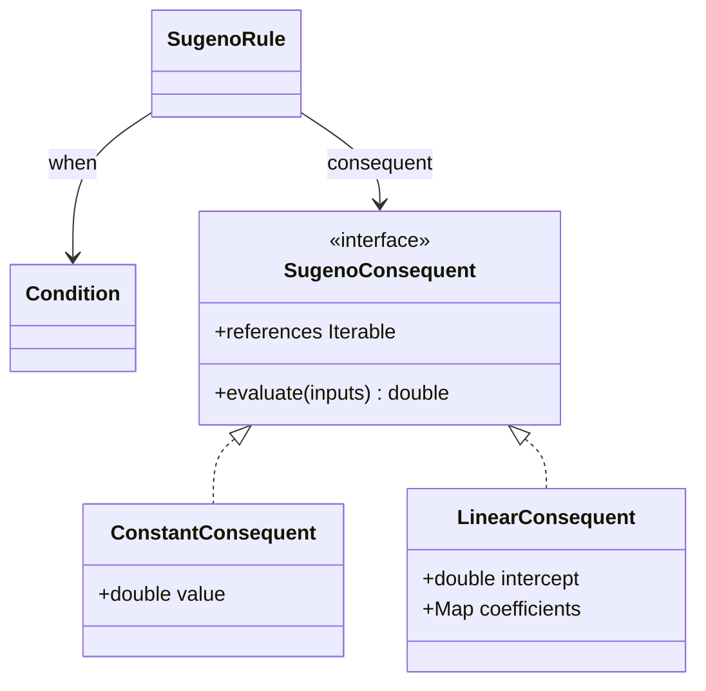

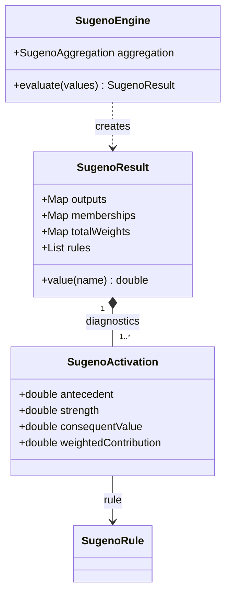

SugenoAggregation selects weightedAverage or weightedSum. Diagram return types omit nullability: result values, inactive consequent values and contributions are nullable. The engines share input validation/fuzzification internally, without sharing their consequent or reduction models. [Sugeno behavior](sugeno.en.md).

## Model interchange and diagnostics / Intercâmbio e diagnóstico

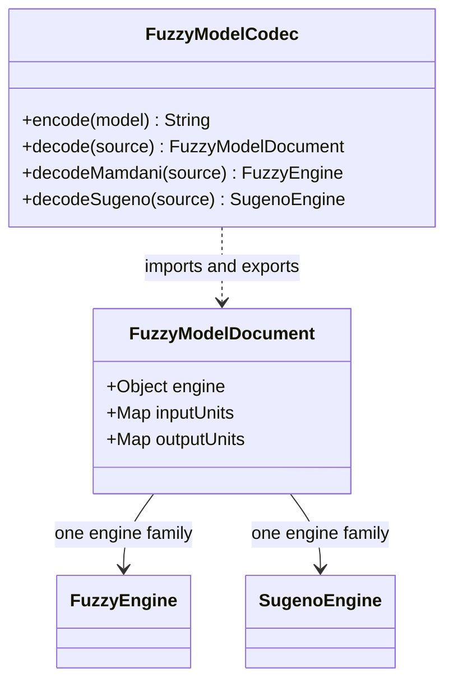

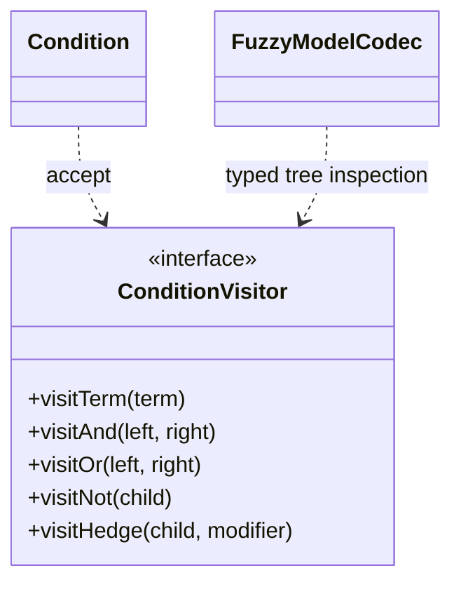

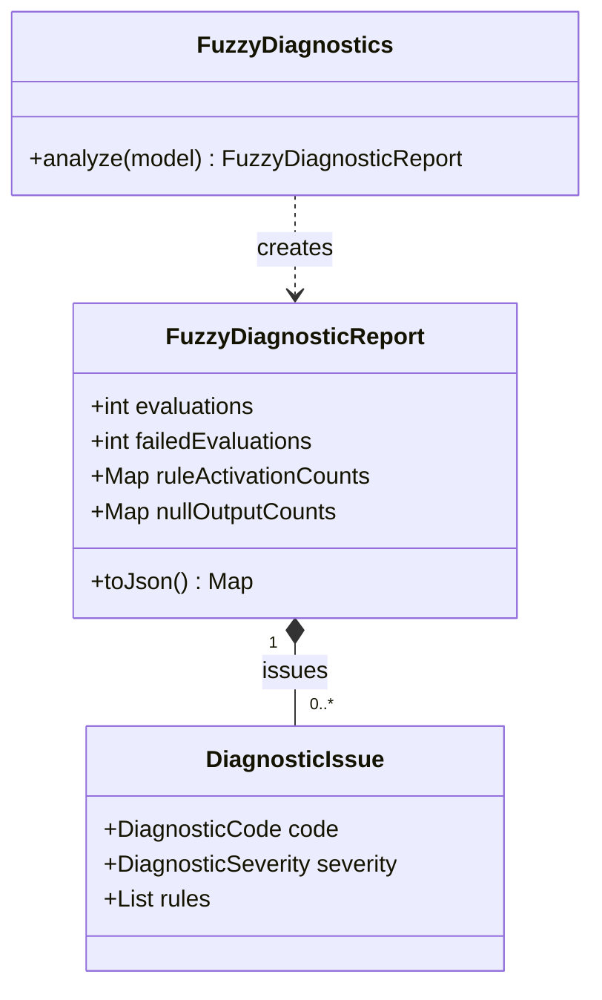

[Model interchange and sampling contracts](model-tools.en.md). ConditionVisitor adds typed inspection without exposing private condition-node implementations.
