# Diagramas de classes e arquitetura

[English](architecture.en.md) · [Escopo e evolução](roadmap.pt-BR.md)

Os diagramas representam o código implementado, não recursos planejados. Estão
separados entre modelo do motor, funções de pertinência e expressões das regras.
O GitHub renderiza estes blocos Mermaid. Leitores Markdown sem esse suporte podem
exibir o código; a documentação da interface pública é gerada com `dart doc`.

## Motor, configuração e resultados

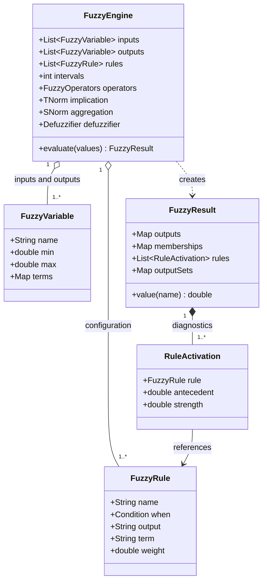

`FuzzyEngine` copia as listas da configuração e valida as referências na construção.
Entradas e saídas usam `FuzzyVariable`, em espaços de nomes separados.
As conclusões das regras referenciam variáveis e termos de saída pelo nome.
`FuzzyResult.value()` retorna **double?**: null significa área agregada zero. O
diagrama omite a nulabilidade para compatibilidade de renderização. Os mapas e
listas do resultado são imutáveis. `RuleActivation` referencia a regra e registra
os graus antes/depois do peso; não representa uma parcela aditiva do centroide.

## Funções de pertinência

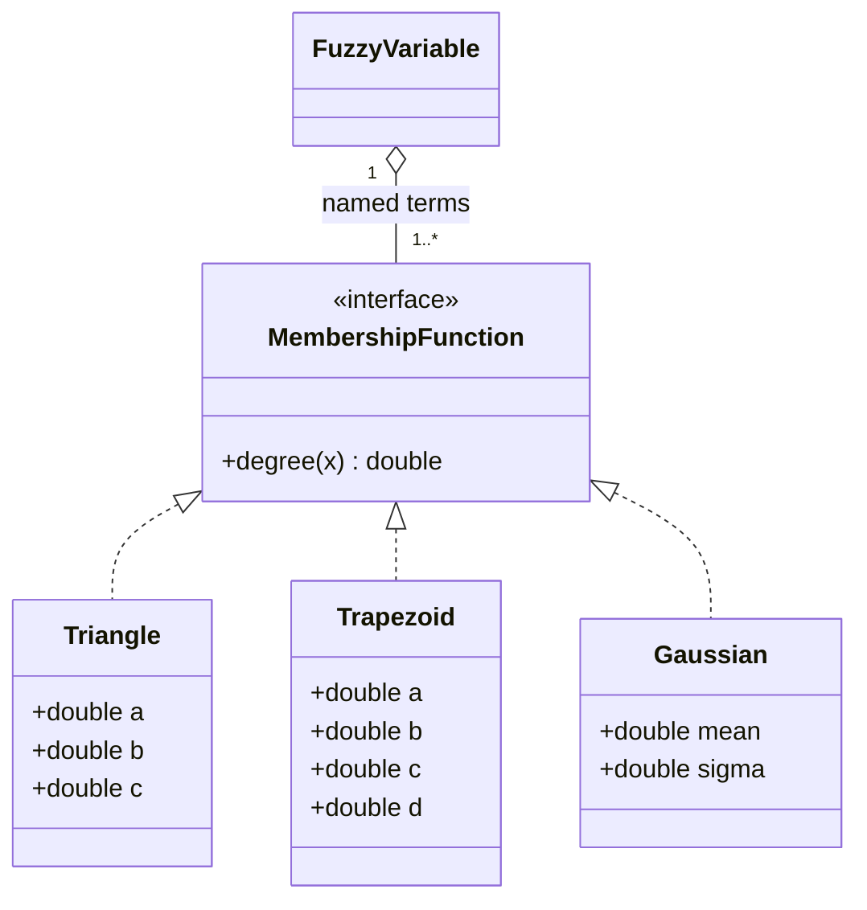

`FuzzyVariable.terms` associa nomes linguísticos a funções `MembershipFunction`.
As funções são referenciadas, sem cópia profunda. Implementações personalizadas
devem ser imutáveis, determinísticas e retornar graus finitos entre zero e um.

## Condições e composição

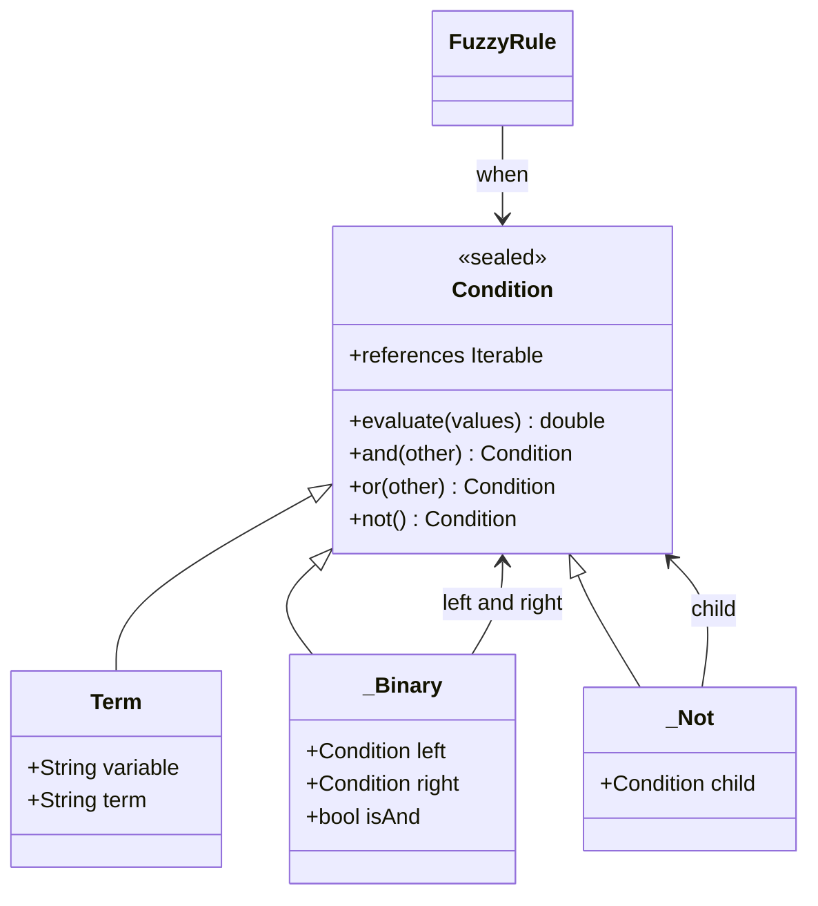

`Term` é público. `_Binary` e `_Not` são classes privadas retornadas por `and`, `or`
e `not`; o usuário não as instancia diretamente. `references` reúne referências
aos termos de entrada para validação antecipada. Os operadores padrão são
AND mínimo, OR máximo e NOT complemento; a configuração FuzzyOperators é propagada
por todas as expressões compostas. `Condition` é sealed; ainda não permite
implementar novas condições fora desta biblioteca.

## Estratégias de inferência

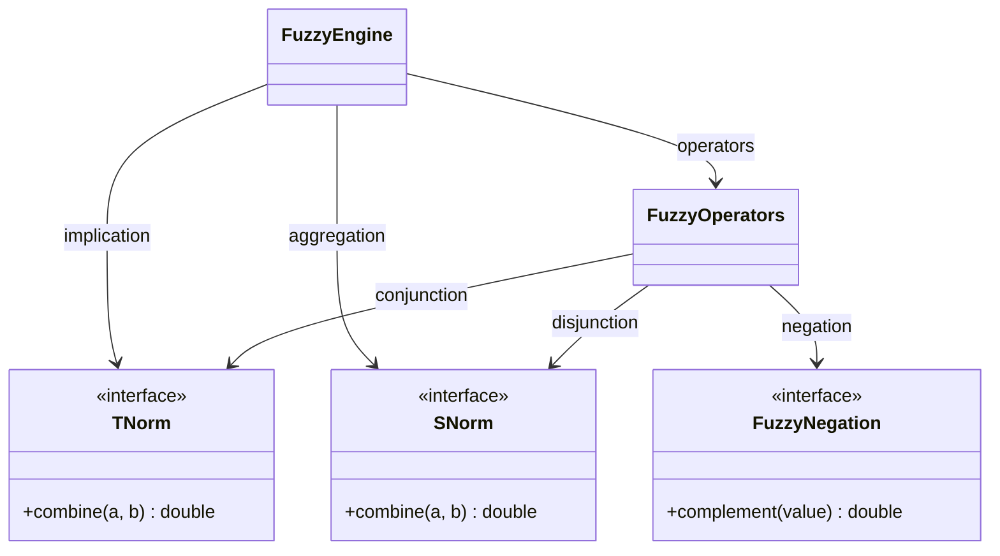

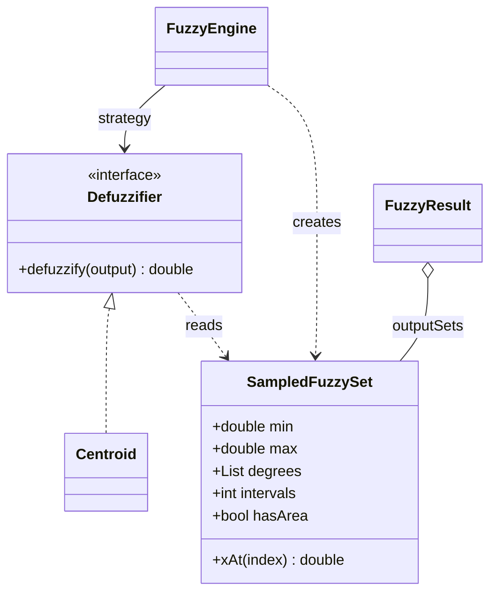

Implemente `MembershipFunction`, `TNorm`, `SNorm`, `FuzzyNegation` ou `Defuzzifier`
para personalizar o pipeline. As estratégias são globais no `FuzzyEngine`.
`FuzzyResult.outputSets` expõe as curvas agregadas imutáveis. `Defuzzifier` retorna
**double?**; a nulabilidade foi omitida no diagrama para compatibilidade.
Veja os [contratos e exemplos](strategies.pt-BR.md). Sugeno agora tem modelo
próprio de consequente e motor, documentados abaixo.

Código: [motor](../lib/src/engine.dart), [modelo](../lib/src/model.dart),
[pertinência](../lib/src/membership.dart), [operadores](../lib/src/operators.dart),
[defuzzificação](../lib/src/defuzzification.dart).

## Additional membership classes / Classes adicionais de pertinência

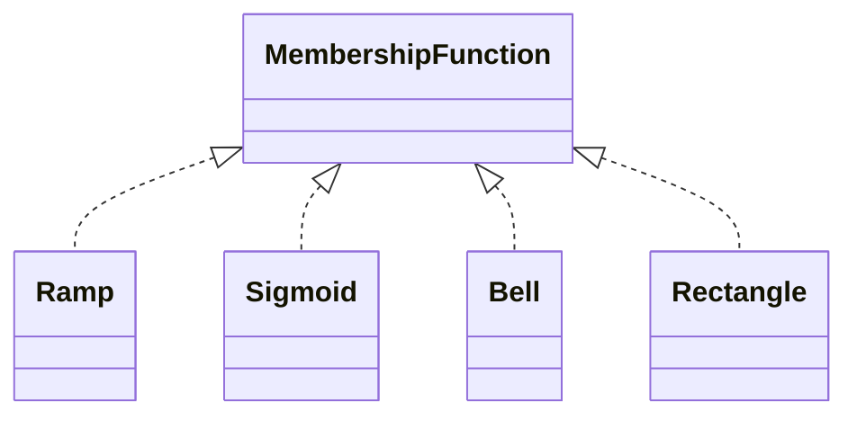

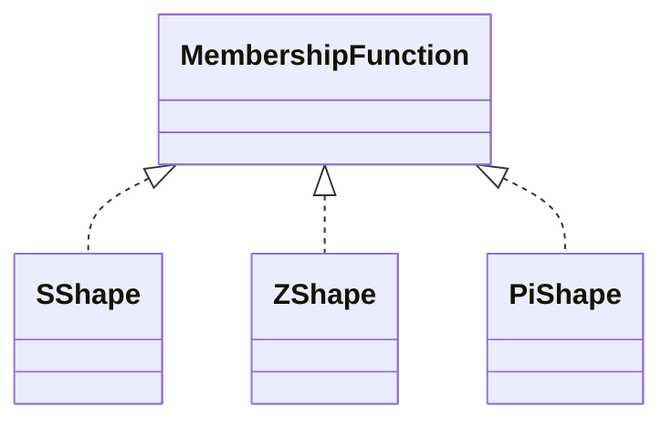

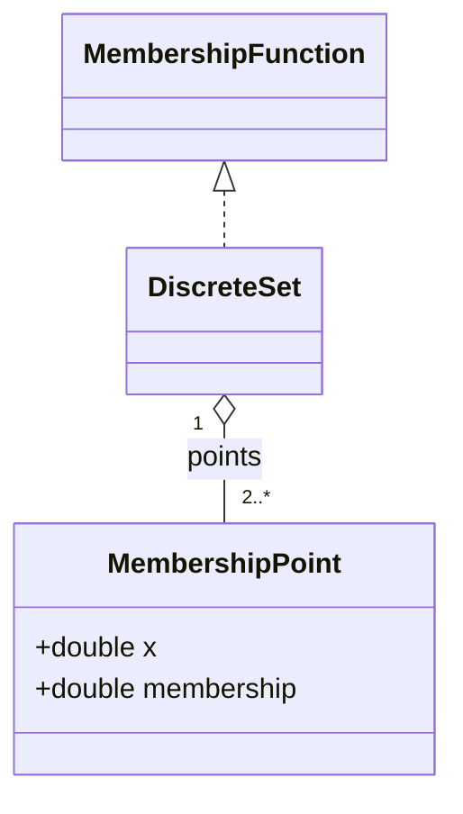

## Defuzzifier implementations / Implementações de defuzzificação

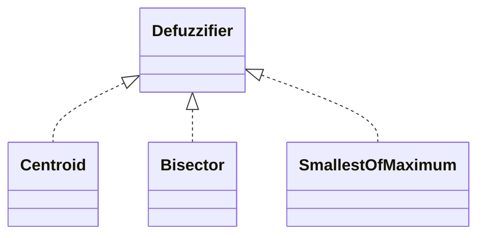

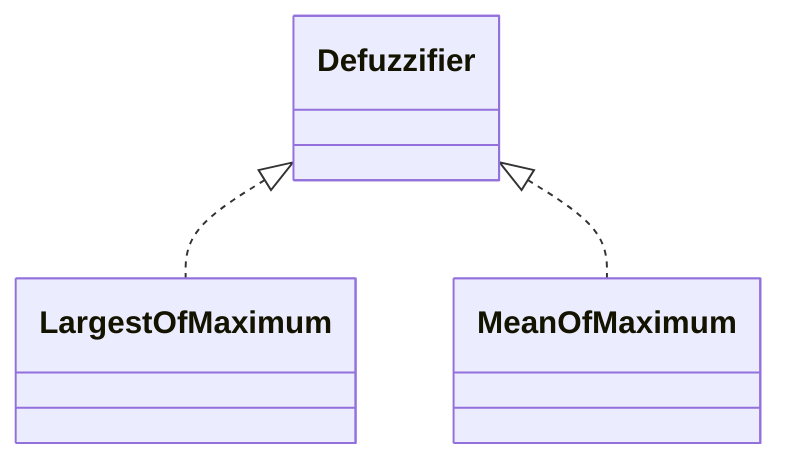

## Linguistic modifiers / Modificadores linguísticos

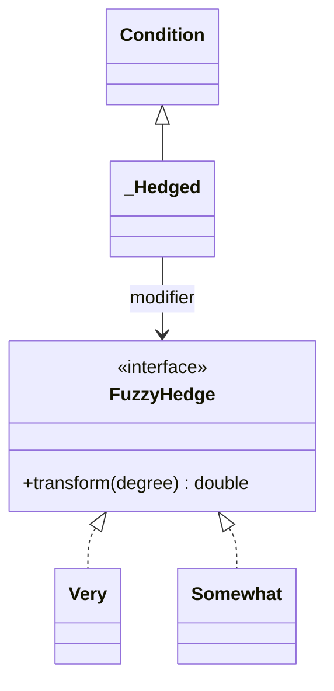

_MaximumDefuzzifier é uma base privada omitida na visão geral; os três métodos de máximos implementam Defuzzifier por ela. _Hedged é privada e criada por Condition.hedge. Veja os [contratos](toolbox.pt-BR.md).

## Sugeno

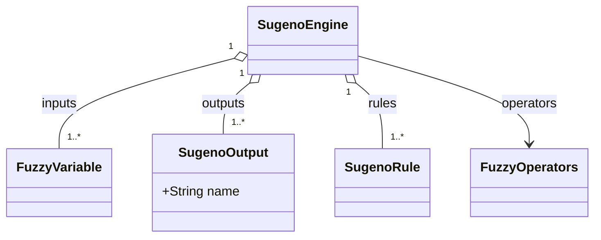

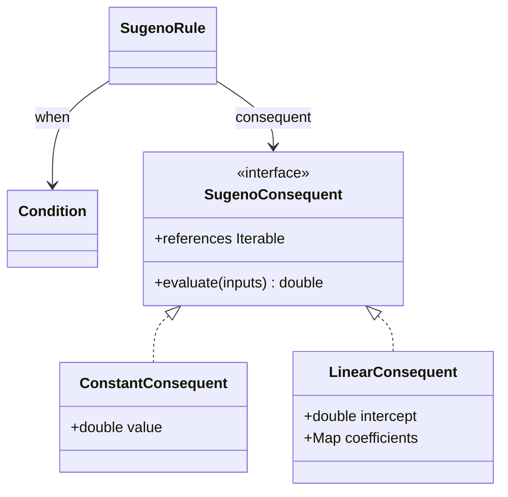

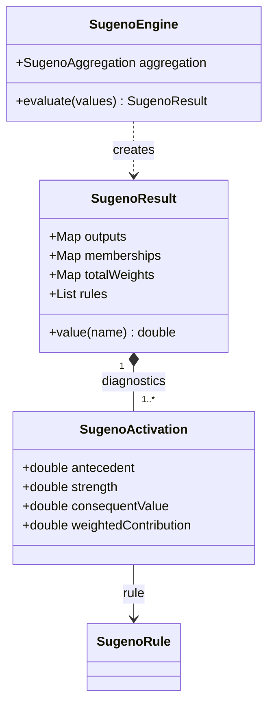

SugenoAggregation seleciona weightedAverage ou weightedSum. Os diagramas omitem nulabilidade: valores de saída e conclusões/contribuições inativas podem ser null. Os motores compartilham validação e fuzzificação das entradas internamente, mantendo modelos próprios de conclusão e redução. [Comportamento Sugeno](sugeno.pt-BR.md).
