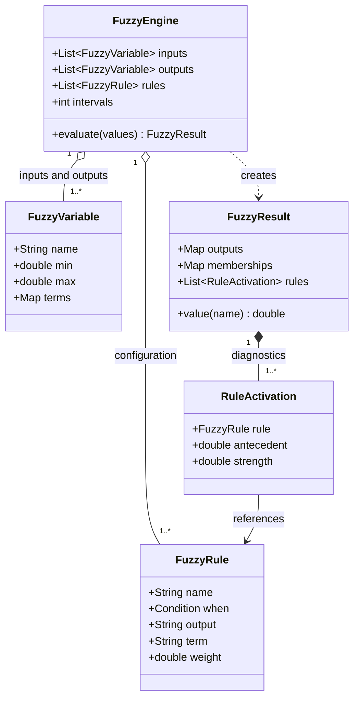
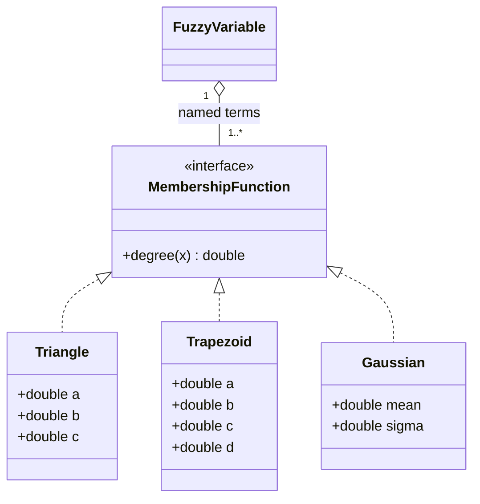
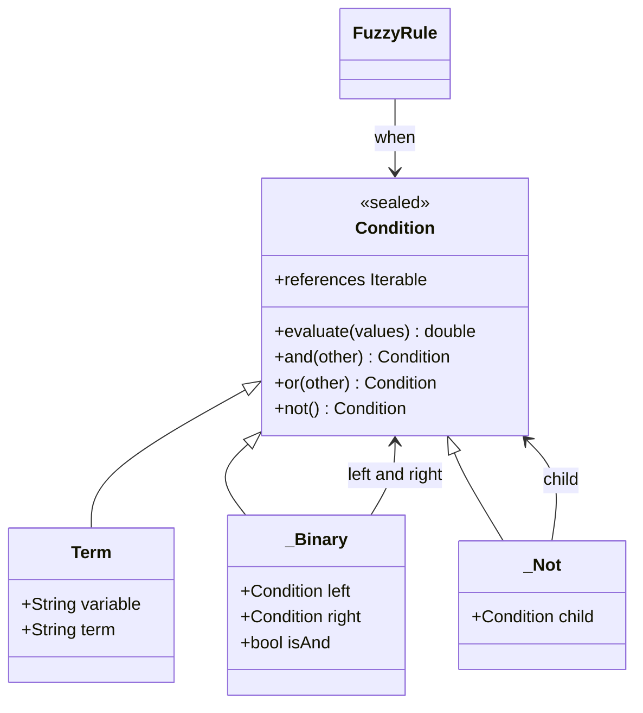

# Diagramas de classes e arquitetura

[English](architecture.en.md) · [Escopo e evolução](roadmap.pt-BR.md)

Os diagramas representam o código implementado, não recursos planejados. Estão
separados entre modelo do motor, funções de pertinência e expressões das regras.
O GitHub renderiza estes blocos Mermaid. Leitores Markdown sem esse suporte podem
exibir o código; a documentação da interface pública é gerada com `dart doc`.

## Motor, configuração e resultados

`FuzzyEngine` copia as listas da configuração e valida as referências na construção.
Entradas e saídas usam `FuzzyVariable`, em espaços de nomes separados.
As conclusões das regras referenciam variáveis e termos de saída pelo nome.
`FuzzyResult.value()` retorna **double?**: null significa área agregada zero. O
diagrama omite a nulabilidade para compatibilidade de renderização. Os mapas e
listas do resultado são imutáveis. `RuleActivation` referencia a regra e registra
os graus antes/depois do peso; não representa uma parcela aditiva do centroide.

## Funções de pertinência

`FuzzyVariable.terms` associa nomes linguísticos a funções `MembershipFunction`.
As funções são referenciadas, sem cópia profunda. Implementações personalizadas
devem ser imutáveis, determinísticas e retornar graus finitos entre zero e um.

## Condições e composição

`Term` é público. `_Binary` e `_Not` são classes privadas retornadas por `and`, `or`
e `not`; o usuário não as instancia diretamente. `references` reúne referências
aos termos de entrada para validação antecipada. Os operadores atuais são fixos:
AND mínimo, OR máximo e NOT complemento. `Condition` é sealed; ainda não permite
implementar novas condições fora desta biblioteca.

## Pontos de extensão

Hoje é possível personalizar funções implementando `MembershipFunction`.
Inferência, implicação, agregação e defuzzificação estão fixadas em `FuzzyEngine`;
ainda não existem interfaces públicas de estratégia. Sugeno precisa de um modelo
próprio de consequente, sem representar funções crisp como conjuntos Mamdani.
O roadmap propõe a sequência de evolução.

Código: [motor](../lib/src/engine.dart), [modelo](../lib/src/model.dart),
[pertinência](../lib/src/membership.dart).
