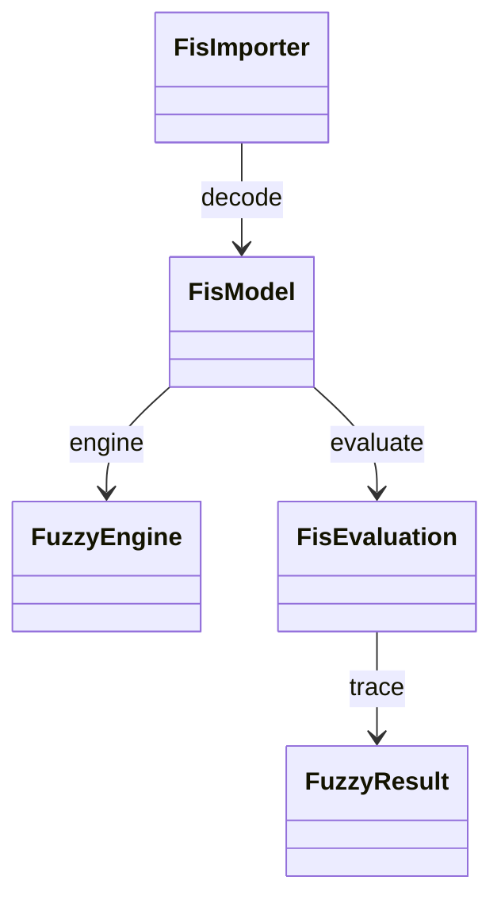

# Experimental FIS import

[Português](fis.pt-BR.md) · [Interoperability roadmap](interoperability.en.md)

Import a restricted, type-1, single-output Mamdani text `.fis` model without
runtime dependencies. This is an experimental syntax/semantics adapter, not a
claim of full MATLAB compatibility. FIS export, Sugeno FIS and FCL are pending.

```dart
final model = FisImporter(
  noDecisionPolicy: FisNoDecisionPolicy.preserveNull,
  intervals: 1000,
).decode(source);
final result = model.evaluate({'temperature': .5, 'humidity': .75});
print(result.value);
print(result.trace.rules.first.strength);
```

Run the console example from the repository root:

```sh
dart run example/fis_example.dart test/fixtures/fis/ventilation.fis
```

## Accepted profile

| Area | Supported |
| --- | --- |
| Sections | Exactly System, contiguous Input1..N, Output1, Rules; order independent |
| System | Name, Type, NumInputs, NumOutputs, NumRules, AndMethod, OrMethod, ImpMethod, AggMethod, DefuzzMethod; optional Version=2.0 |
| Variables | Name, finite increasing Range, NumMFs, contiguous MF1..N |
| Memberships | trimf [a b c], trapmf [a b c d], gaussmf [sigma center] |
| Antecedents | Integer MF indices; zero ignores an input; negative complements a term; at least one nonzero input |
| Consequent | Exactly one positive MF index, weight in [0,1] |
| Connectives | 1=flat AND, 2=flat OR; min/prod AND, max/probor OR |
| Output | min/prod implication, max aggregation, centroid |
| Text | Case-sensitive fields; nonempty single-quoted names without embedded quotes; whitespace-separated decimal vectors; percent comments outside quotes; LF or CRLF |

No unknown field is silently discarded. Unsupported sections, versions, functions,
methods, counts and indices throw FormatException with a line number. The whole
source length limit and a missing System section report file-level errors.
Negative/zero output indices, fractional hedges, all-ignored antecedents, custom
functions, multi-output and other engine families are rejected. Generated rule
names are rule1, rule2, etc.; numeric FIS rules do not carry our named rule labels.

## Evaluation contracts

`noDecisionPolicy` is required. `preserveNull` keeps zero-area outputs null;
`midpoint` substitutes the declared universe midpoint; `throwError` fails.
The policy covers both no activation and active rules whose output is missed by
the sample grid. `usedFallback` identifies numeric substitution; `trace` always
contains the unmodified core result. Calling `model.engine.evaluate` bypasses the
adapter policy. This does not change core engine defaults.

The importer does not emulate vendor warnings or out-of-range handling: core input
validation still rejects missing, extra, nonfinite and out-of-range inputs. The
MathWorks documented warning/none policy uses the midpoint for no-rule and empty
output cases; selecting midpoint here implements only that substitution.

Resolution is external configuration. `intervals=1000` means 1001 equally spaced
samples including both endpoints and composite trapezoidal centroid integration.
FIS does not store this setting; matching a sample count alone does not establish
matching quadrature. There are no cross-tool numerical-equivalence claims yet.

Source length defaults to 1,000,000 UTF-16 code units, inputs to 64, rules to 4096
and memberships per variable to 256. Counts are checked before allocation of model
components. Intervals must be between 2 and 1,000,000. Caller-supplied higher count
limits deliberately increase allowed work; source is parsed as data, never eval.

## Verification and architecture

43 tests cover independent five-point quadrature, activations, endpoint shoulders,
Gaussian parameter order, alternative operators, zero-area policies, malformed
files and budgets. The original fixture documents its derivation and provenance
in test/fixtures/fis/README.md. It is not a vendor export. Independent external
fixtures and numerical comparison remain release gates for stronger compatibility
claims. `benchmark/fis_benchmark.dart` measures parsing/construction separately
from inference and file reading.



Primary references:
- [Text FIS structure and rule conventions](https://help.functionbay.com/2026/RecurDynHelp/Colink/Colink_ch06_s12_02.html)
- [Gaussian parameter order](https://www.mathworks.com/help/fuzzy/gaussmf.html)
- [MathWorks evaluation options](https://la.mathworks.com/help/fuzzy/fuzzy.evalfis.evalfisoptions.html)
