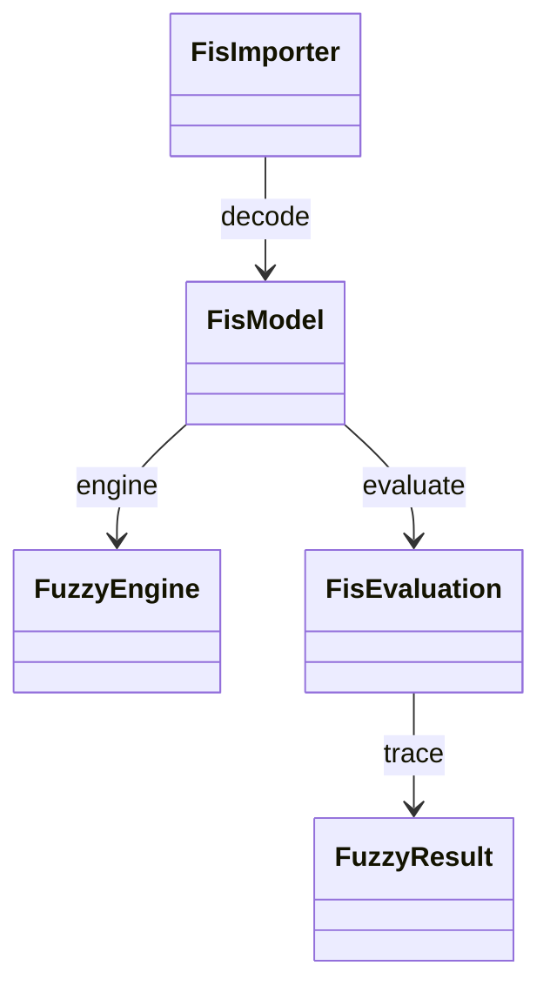

# Importação experimental de FIS

[English](fis.en.md) · [Roadmap de interoperabilidade](interoperability.pt-BR.md)

Importe um modelo textual `.fis` Mamdani tipo 1, com uma saída, sem dependências
no núcleo. É um adaptador experimental de sintaxe e semântica, sem promessa de
compatibilidade completa com MATLAB. Exportação FIS, Sugeno em FIS e FCL seguem pendentes.

```dart
final model = FisImporter(
  noDecisionPolicy: FisNoDecisionPolicy.preserveNull,
  intervals: 1000,
).decode(source);
final result = model.evaluate({'temperature': .5, 'humidity': .75});
print(result.value);
print(result.trace.rules.first.strength);
```

Execute o exemplo na raiz do repositório:

```sh
dart run example/fis_example.dart test/fixtures/fis/ventilation.fis
```

## Perfil aceito

| Área | Suporte |
| --- | --- |
| Seções | Exatamente System, Input1..N contíguos, Output1 e Rules; ordem livre |
| Sistema | Name, Type, NumInputs, NumOutputs, NumRules, AndMethod, OrMethod, ImpMethod, AggMethod, DefuzzMethod; Version=2.0 opcional |
| Variáveis | Name, Range finito e crescente, NumMFs, MF1..N contíguos |
| Pertinência | trimf [a b c], trapmf [a b c d], gaussmf [sigma centro] |
| Antecedentes | Índices inteiros; zero ignora uma entrada; negativo complementa um termo; pelo menos uma entrada não ignorada |
| Consequente | Um índice positivo e peso em [0,1] |
| Conectivos | 1=AND plano, 2=OR plano; AND min/prod e OR max/probor |
| Saída | Implicação min/prod, agregação max, centroide |
| Texto | Campos sensíveis a maiúsculas; nomes não vazios entre aspas simples sem aspas internas; vetores decimais separados por espaço; comentários % fora de aspas; LF ou CRLF |

Campos desconhecidos não são descartados. Seções, versões, funções, métodos,
contagens e índices não suportados causam FormatException com número da linha.
Limite global de tamanho e ausência de System geram erros do arquivo inteiro.
Índices de saída negativos/zero, modificadores fracionários, antecedentes totalmente
ignorados, funções personalizadas, múltiplas saídas e outras famílias são rejeitados.
As regras recebem nomes rule1, rule2 etc.; regras numéricas FIS não têm nossos nomes.

## Contratos de avaliação

`noDecisionPolicy` é obrigatório. `preserveNull` mantém null para área zero;
`midpoint` substitui pelo ponto médio do universo; `throwError` lança erro.
Isso cobre falta de ativação e regras ativas cuja saída não seja capturada pela
malha de amostragem. `usedFallback` indica substituição numérica; `trace` conserva
o resultado original. Chamar `model.engine.evaluate` diretamente ignora a política
do adaptador. Os padrões do núcleo permanecem os mesmos.

O importador não reproduz os avisos nem o tratamento de entradas fora da faixa de
outras ferramentas: o núcleo rejeita entradas ausentes, extras, não finitas ou fora
do universo. A opção warning/none documentada pela MathWorks usa o ponto médio em
casos sem regra ou saída vazia; a opção midpoint implementa apenas essa substituição.

A resolução é configuração externa: `intervals=1000` usa 1001 amostras uniformes,
incluindo extremos, e centroide por integração trapezoidal composta. FIS não guarda
essa configuração. Igualar a quantidade de amostras não garante a mesma quadratura.
Ainda não há garantia de equivalência numérica entre ferramentas.

Limites padrão: 1.000.000 unidades UTF-16 no texto, 64 entradas, 4096 regras e 256
funções de pertinência por variável. As contagens são verificadas antes de construir
os componentes. Intervalos devem ficar entre 2 e 1.000.000. Aumentar os limites de
contagem permite mais trabalho deliberadamente; texto nunca é executado como código.

## Validação e arquitetura

43 testes cobrem quadratura independente com cinco amostras, ativações, extremos,
ordem dos parâmetros gaussianos, operadores alternativos, políticas para área zero,
arquivos inválidos e limites. A origem e a derivação da fixture original estão em
test/fixtures/fis/README.md. Ela não foi exportada por ferramenta externa. Fixtures
externas e comparação numérica continuam necessárias para alegações mais fortes
de compatibilidade. `benchmark/fis_benchmark.dart` mede importação e construção,
separadamente da inferência e da leitura do arquivo.



Referências primárias:
- [Estrutura textual FIS e convenções de regras](https://help.functionbay.com/2026/RecurDynHelp/Colink/Colink_ch06_s12_02.html)
- [Ordem dos parâmetros gaussianos](https://www.mathworks.com/help/fuzzy/gaussmf.html)
- [Opções de avaliação MathWorks](https://la.mathworks.com/help/fuzzy/fuzzy.evalfis.evalfisoptions.html)
